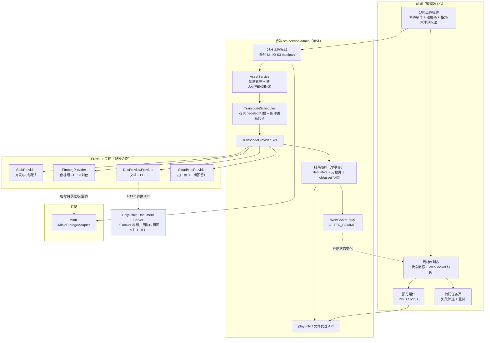
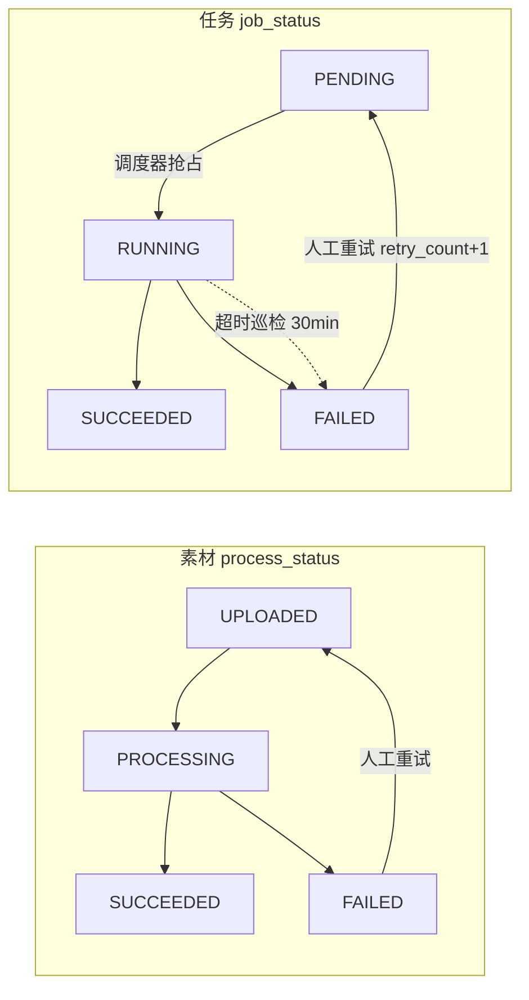
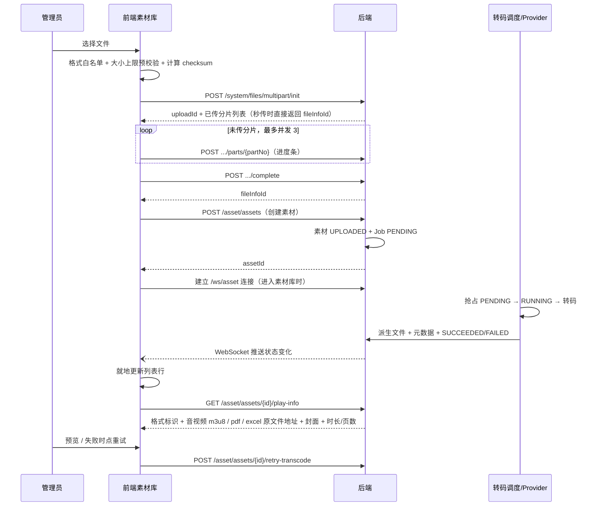

# 素材转码设计方案（前后端）

编制日期：2026-07-23
状态：**讨论点已全部确认（2026-07-23）**，按第 9 节批次进入实施；涉及 DDL 变更（当前判断：无）须另走 OpenSpec + migration。
2026-07-24 更新：对齐魔学院（成熟培训 SaaS）格式基准——视频/音频白名单扩充、单文件上限音视频 3GB/文档 500MB；确认 *
*Excel（xls/xlsx）不进转码链，限 10MB 前端直显**（vue-office 实测通过）；文件代理必须透传 HTTP Range。PDF
线性化最初列为二期，并于 2026-08-13 确认为所有 PDF 无条件执行。均为配置级改动，架构不变。文档转换引擎同日由 LibreOffice调整为
**OnlyOffice Document Server**（
`onlyoffice/documentserver:9.2` 容器 + HTTP 转换 API，见 D2/附录 A/B.3），SPI 不变。
2026-08-28 更新：AUDIO 成功产物由单文件 MP3（`TRANSCODED`）改为与视频对齐的 **AAC 128kbps、5 秒独立切片 HLS**（无封面），play-info 返回
`format=hls` 并走既有 HLS 文件代理；不再把遗留 `TRANSCODED` MP3 当作可播格式。对应 OpenSpec
`2026-08-28-switch-audio-transcode-to-hls`。

## 0. 已确认结论速览

| #    | 议题    | 结论（2026-07-23 确认）                                                                             |
|------|-------|-----------------------------------------------------------------------------------------------|
| D1   | 存储介质  | **MinIO**（新增 `MinioStorageAdapter`；开发期可继续本地实现）                                                |
| D2   | 转码引擎  | **自建 FFmpeg（音视频）+ OnlyOffice Document Server（文档→PDF）**（2026-07-24 由 LibreOffice 调整），SPI 预留云厂商 |
| D3   | 视频输出  | **HLS，单码率 720p 起步**；多码率自适应二期                                                                  |
| D3.3 | 音频输出  | **AAC 128kbps、5 秒独立切片 HLS**（无封面）；play-info 不兼容遗留 TRANSCODED MP3（2026-08-28）                   |
| D4   | 文档预览  | **统一转 PDF 并由 qpdf 全量线性化**，前端 pdf.js 翻页；**Excel 例外：≤10MB 不转码，前端表格组件直显**（2026-08-13 补充确认）       |
| D5   | 任务调度  | **DB 轮询定时任务**（`@Scheduled` + 条件更新抢占），执行器暂驻单体本地                                                |
| D6   | 状态刷新  | **WebSocket 推送**，断线降级轮询兜底                                                                     |
| D7   | 大文件上传 | **分片上传 + 断点续传纳入本期**（映射 MinIO S3 multipart）                                                    |
| D8   | 完成通知  | **实时通知走 WebSocket**（与 D6 同通道）；离线站内信留 `TranscodeCompletedEvent` 挂接点，等消息模块交付后订阅                 |

## 1. 背景与现状

### 1.1 已有能力

| 项     | 现状                                                                                                                                                                                                                              |
|-------|---------------------------------------------------------------------------------------------------------------------------------------------------------------------------------------------------------------------------------|
| 表结构   | `sts_asset_asset`（含 `process_status/duration_seconds/page_count/checksum`）、`sts_asset_derivative`（PREVIEW/TRANSCODED/THUMBNAIL/HLS）、`sts_asset_transcode_job`（含 `provider_job_id/retry_count/failure_code`）已建，**字段能力足够，本方案不改表** |
| 后端    | 素材 CRUD、状态机门禁（转码中不可编辑/删除/引用，错误码 6012/6022/6023）、任务列表与失败重试 API 已实施                                                                                                                                                               |
| 转码执行  | **进程内同步桩** `TranscodeStub`：创建音视频素材后立即置 SUCCEEDED，不产生派生文件、不提取元数据                                                                                                                                                                 |
| 文件存储  | `StorageAdapter` 抽象 + `LocalStorageAdapter` 本地磁盘实现；上传走 `/system/files` 拿 `fileInfoId`                                                                                                                                           |
| 文档/图片 | 创建后直接 SUCCEEDED，无预览转换                                                                                                                                                                                                           |

### 1.2 为什么必须做真实转码

1. **学习规则依赖元数据**：材料规则 AUTO 时长模式需要音视频 `duration_seconds`（× 完成比例）和文档 `page_count`（×
   每页秒数）；桩实现下这两个字段为空，学习完成口径无法落地。
2. **在线播放与预览**：学员端需要统一可播格式（原始 avi/mov/wmv 浏览器放不了）、文档需要在线翻页预览；音视频均用 HLS 分片，弱网起播快、拖动快，且可走同一套带鉴权的分片代理。
3. **课程防作弊前提**：禁止快进、断点续播、水印都建立在"后端可控的播放载体"上；HLS 切片同时天然防直链下载。

## 2. 目标 / 非目标

**目标：**

- 音视频真实转码（视频单码率 HLS + 封面；音频 AAC HLS 切片、无封面；时长提取）。
- 文档预览转换（PDF + 页数提取）。
- MinIO 对象存储接入与分片上传、断点续传。
- 异步任务调度：状态机硬化、并发抢占、超时回收、失败分类与重试。
- WebSocket 状态推送（转码状态变化实时到前端）。
- 转码引擎可插拔（SPI），桩实现保留用于开发与集成测试。
- 前端素材库的上传、状态展示、预览、重试完整交互契约。

**非目标（本方案不做）：**

- 多码率自适应 HLS、DRM 加密、AI 字幕、直播转推、人脸识别（延期/二期）。
- 离线站内信通知（等消息模块，见 D8）。
- 题目侧素材引用检查扩展（预留接口不变）。
- 独立转码微服务——按单体原则在 `sts-service-admin` 内实现，执行器可后移。

## 3. 总体架构



要点：

- 调度、执行、落库都在单体内；`TranscodeProvider` 是唯一扩展点，替换引擎不动业务代码。
- 转码执行（外部进程）严格在数据库事务之外；只有状态流转和结果落库进事务。
- Provider 执行时从 MinIO 拉源文件到本机临时目录，产物回传 MinIO 后再落库；临时目录任务结束即清理。文档转换例外：OnlyOffice
  容器按内网 URL 自行拉取源文件，后端只下载产物回传。

## 4. 讨论点决策记录

> 8 项均已于 2026-07-23 逐项确认，结论见第 0 节速览；本节保留备选方案与理由，供后续回溯。

### D1 文件存储介质 → 结论：MinIO

| 方案               | 说明                                      | 代价                    |
|------------------|-----------------------------------------|-----------------------|
| A. 本地磁盘（现状）      | 继续 `LocalStorageAdapter`                | 单机容量/带宽上限；多实例部署时文件不共享 |
| **B. MinIO（选定）** | 新增 `MinioStorageAdapter`；S3 协议，分片上传原生支持 | 多一个运维组件               |
| C. 云 OSS         | 同 B，可与云转码打通                             | 云绑定 + 费用              |

选 B 理由：解除单机限制、S3 multipart 与 D7 分片上传天然配套、内网可部署不绑云。开发期 `LocalStorageAdapter` 保留（配置切换），集成测试可用
Testcontainers MinIO。

### D2 转码执行引擎 → 结论：自建 FFmpeg（音视频）+ OnlyOffice（文档，2026-07-24 由 LibreOffice 调整）

| 方案            | 说明                                                    | 代价                                   |
|---------------|-------------------------------------------------------|--------------------------------------|
| **A. 自建（选定）** | FFmpeg（音视频）+ OnlyOffice（Office→PDF）+ qpdf（所有 PDF 线性化） | 需要维护 OnlyOffice 容器及后端主机 qpdf；转码资源需限流 |
| B. 云厂商转码      | 远程任务 + 回调                                             | 云绑定、费用、内网不可用                         |

SPI 预留 B 的位置（`provider_job_id` 字段为其保留），二期若有需要可加 `CloudMpsProvider` 不动业务层。

**2026-07-24 补充确认：文档转换引擎由 LibreOffice 调整为 OnlyOffice Document Server**（官方镜像
`onlyoffice/documentserver:9.2`，Docker 单容器自建，仍属方案 A"自建"范畴）。对比：

| 文档引擎                               | 还原度                          | 调用方式                           | 主要代价                                |
|------------------------------------|------------------------------|--------------------------------|-------------------------------------|
| **OnlyOffice Document Server（选定）** | docx/pptx 开源最佳（OOXML 是其原生格式） | HTTP 转换 API，天然支持并发             | 多一个 Docker 容器（与 MinIO 同级）；中文字体需注入容器 |
| LibreOffice headless（原选）           | 复杂版式偏差较多                     | 应用机 soffice 进程，需自管单实例/进程池/崩溃重启 | 进程管理复杂，占应用机 CPU                     |

- HTTP API 免去 soffice 进程管理的整块复杂度（单实例限制、UserInstallation 目录、超时强杀），`DocPreviewProvider` 退化为一次
  HTTP 调用；文档转换负载从应用机卸载到容器。
- 老二进制格式（.doc/.ppt）还原度与 LibreOffice 互有胜负，仍以"转 PDF 上传"提示兜底。
- 社区版 AGPL 许可，自部署内部使用无合规问题；其编辑并发限制不影响转换场景。

### D3 视频输出规格 → 结论：单码率 HLS（720p）

| 方案                        | 说明                       | 代价                        |
|---------------------------|--------------------------|---------------------------|
| A. 单档 MP4 + 封面            | `<video>` 直接播            | 弱网卡缓冲、拖动慢、直链易下载           |
| **B. HLS + 封面（选定，单码率起步）** | 切片边下边播：起播快、拖动快、弱网稳、防直链下载 | 前端需 hls.js（轻）；多码率才会显著增加成本 |

确认口径：**单码率 720p（H.264/AAC）HLS 切片**，转码成本与 MP4 相当；一期采用 5 秒目标切片、切片边界强制 IDR
关键帧并声明独立切片；多码率自适应作为二期升级，表结构无需变更（derivative_type=HLS 已预留）。

#### D3.1 HLS 切片与关键帧策略（2026-08-26 补充确认）

本系统是课程点播而非低延迟直播。切片目标是在兼顾请求数量和存储开销的前提下，缩短首片下载时间并确保拖动后可以独立解码：

1. 一期选用 **5 秒 MPEG-TS 切片**；不使用 1～2 秒超短切片，避免请求数量和存储对象数量过度增长。
2. 在 5 秒边界强制生成 IDR 关键帧，并使用 closed GOP；不得仅修改 `hls_time` 后继续等待不确定的源 GOP 边界。
3. 为播放列表写入 `EXT-X-INDEPENDENT-SEGMENTS`，其前提是每个视频切片确实从关键帧开始；不得使用
   `split_by_time` 将普通帧强行作为切片起点。
4. 5 秒用于当前 PC、移动端课程点播的工程折中；Apple HLS Authoring Specification 推荐的通用目标是名义 6 秒，并要求视频切片从
   IDR 帧开始、切片不得比目标时长多 0.5 秒以上。后续如以 Apple 全量合规校验为交付目标，可独立评估切换至 6 秒。
5. 二期演进为 360p/540p/720p 多码率自适应 HLS；所有码率档位必须使用相同切片时长和对齐的关键帧边界，由 Master Playlist
   供播放器按实时吞吐量切换。单纯缩短切片只改善起播和拖动粒度，不降低视频总码率，也不替代 ABR。

真实样片 `test/La Paloma.mp4`（153.04 秒、640×360、源文件约 6.44 MiB）在保持相同音视频编码参数时的对比：

| 指标     | 原 10 秒目标、未强制边界关键帧 | 5 秒目标、强制边界关键帧 |
|--------|------------------:|--------------:|
| 切片数量   |                16 |            31 |
| 实际切片时长 |      3.03～16.67 秒 |   3.03～5.00 秒 |
| 首片大小   |        706.47 KiB |    197.18 KiB |
| 最大切片   |        758.06 KiB |    241.79 KiB |
| 平均切片   |        424.11 KiB |    232.04 KiB |
| TS 总体积 |          6.63 MiB |      7.02 MiB |

结论：5 秒方案将首片缩小约 72%、平均切片缩小约 45%，代价是切片数量接近翻倍且 TS 总体积增加约 5.9%。该结果只证明当前样片的
切片粒度收益，不作为所有视频压缩率的承诺；复杂度、帧率和内容不同会导致切片大小变化。

#### D3.2 源分辨率与播放码率（2026-08-27）

`scale=-2:min(720,ih)` 只缩小、不放大：低于 720p 的源按原高度播出，1080p/4K 先缩成 720p 再编 HLS。播放带宽不按源像素线性增加。

| 源分辨率             | 学员实际看到的      | 对带宽的含义              |
|------------------|--------------|---------------------|
| 640×360 一类亚 720p | 仍是 360p（不放大） | 码率会明显低于 720p 课      |
| 1280×720         | 720p         | 点播上限档               |
| 1920×1080 / 4K   | 先缩成 720p 再播  | 不会按 1080p/4K 去拉播放带宽 |

2026-08-27 用与生产一致的 `FfmpegCommandFactory.video` 对 10 秒、30 fps 合成源测算（平均码率 = `.ts` 总体积 × 8 ÷
时长；非并发压测、非客户课件）：

| 源                             | 转完 HLS   |        平均码率 |
|-------------------------------|----------|------------:|
| La Paloma（历史，640×360，约 153 s） | 640×360  | 约 0.37 Mbps |
| 640×360 `testsrc2`            | 640×360  |   0.90 Mbps |
| 1280×720 `testsrc2`           | 1280×720 |   2.95 Mbps |
| 1920×1080 `testsrc2`          | 1280×720 |   1.61 Mbps |
| 3840×2160 `testsrc2`          | 1280×720 |   1.02 Mbps |
| 1280×720 纯色 / SMPTE 色条        | 1280×720 |   0.18 Mbps |

La Paloma 约 0.4 Mbps 不能代表 720p 课。1080p/4K 增加的是源存储和转码 CPU；学员侧最高仍是 720p。`testsrc2` 缩小后码率低于原生
720p 复杂图案，是合成图案被低通滤波，真实摄像头 1080p 缩到 720p 一般接近同场景原生 720p。部署规划中的 2.0～2.5
Mbps/路假说与容量公式见
[customer-environment-survey.md](../deployment/customer-environment-survey.md) §4.1。

参考依据：

- [Apple HLS Authoring Specification](https://developer.apple.com/documentation/http-live-streaming/hls-authoring-specification-for-apple-devices/)
- [FFmpeg HLS muxer documentation](https://ffmpeg.org/ffmpeg-formats.html)
- [AWS MediaConvert video quality and GOP guidance](https://docs.aws.amazon.com/mediaconvert/latest/ug/video-quality.html)

#### D3.3 音频输出规格（2026-08-28）

一期曾把 AUDIO 转成单文件 128kbps MP3（`derivative_type=TRANSCODED`），play-info 返回 `format=mp3`。私有文件必须带
Bearer，原生 `<audio src>` 加不上该头，管理端/学员端会先把整份 MP3 下载成 Blob 再播，长课时起播慢，也无法复用视频已有的按片拉、鉴权
xhr。

| 方案 | 说明 | 结论 |
|------|------|------|
| 单文件 MP3 + 自管 Range / 预签名 URL | 保住 MP3，另做鉴权胶水 | 未选：与视频播放栈分叉，MSE 对 MP3 支持差 |
| **AAC 128kbps、5 秒独立切片 HLS（选定）** | 无封面；对象前缀与视频相同 `hls/`；play-info `format=hls` | 复用 hls.js、HLS 文件代理和 5 秒切片策略 |
| MP3 封装进 HLS | 切片但仍用 MP3 | 未选：浏览器/Safari 对 MP3-in-HLS 兼容差 |

确认口径：

1. 新 `AUDIO_TRANSCODE` 成功产物为 AAC-in-TS HLS，切片目标 **5 秒**、`independent_segments`、`vod`，与视频音轨参数对齐；**不**生成
   THUMBNAIL，**不**再写 `TRANSCODED` MP3。
2. 音频无画面，不使用视频的 IDR/`force_key_frames`；独立切片由 AAC 访问单元边界承担。
3. play-info：存在 HLS 时 `format=hls`，url 为既有 `/api/asset/files/{assetId}/hls/{jobId}/index.m3u8`；没有 HLS 时返回
   `original`，即使库中仍有遗留 `TRANSCODED` 行。不自动重转、不删除旧 MP3 派生。
4. 下载仍走原始上传文件，不额外提供「转码 MP3 下载」。
5. 表结构不改：AUDIO 与 VIDEO 是不同 `asset_id`，均可拥有 `derivative_type=HLS`。
6. play-info `format` 枚举不再包含 `mp3`。

规格来源：OpenSpec `2026-08-28-switch-audio-transcode-to-hls`。

### D4 文档预览载体 → 结论：统一转 PDF

| 方案                                   | 说明                                                                            | 代价                                    |
|--------------------------------------|-------------------------------------------------------------------------------|---------------------------------------|
| **A. 转 PDF + qpdf 线性化 + pdf.js（选定）** | 一个派生文件；所有 PDF 无条件线性化；`page_count` 取最终 PDF 页数；"最后一页强制"由 pdf.js 页码事件支撑；矢量渲染放大不糊 | 增加 qpdf 后端运行依赖和异步处理耗时；文字可复制（水印兜底，可接受） |
| B. 逐页转图片                             | 防复制最强                                                                         | 存储放大、缩放体验差、派生模型要改一对多（需改表）             |

**2026-07-24 补充确认：Excel（xls/xlsx）例外——不进转码链，限 10MB 前端直显。** 起因：实测 LibreOffice 转宽表 Excel
按竖版页宽切列、一行显示不全。备选对比：

| Excel 方案                | 说明                                                                  | 结论/未选原因                          |
|-------------------------|---------------------------------------------------------------------|----------------------------------|
| **直显 ≤10MB（选定）**        | 不建 Job 直接 SUCCEEDED，前端表格组件（vue-office，实测效果好）渲染原文件；合并单元格/样式保真、宽表横向滚动 | 后端零开发；图表不渲染、需水印场景走"转 PDF 上传"自助兜底 |
| 转 PDF（SinglePageSheets） | LibreOffice ≥7.2 每 sheet 整页导出，列不切割                                  | 超大 sheet 单页尺寸超限，页数语义失真           |
| 转 Markdown              | POI 读取拼 Markdown 表，前端轻渲染                                            | 合并单元格/多级表头必碎，保真度最差               |
| POI 检测三路由               | 按合并单元格/图表/行数把简单表转 md、复杂表转 PDF                                       | 实现最重，违背从简原则                      |

### D5 任务调度方式 → 结论：DB 轮询定时任务（执行器暂驻单体）

| 方案               | 说明                                                      | 代价               |
|------------------|---------------------------------------------------------|------------------|
| **A. DB 轮询（选定）** | `@Scheduled` 定时扫 PENDING + 条件更新抢占；`idx_status_time` 已备好 | 秒级延迟（转码本身分钟级，无感） |
| B. 消息队列          | 实时触发                                                    | 新增中间件 + 两套幂等逻辑   |

确认口径：定时任务方式，转码执行**暂时在单体本地**进行；量大后可把执行器拆独立进程部署（SPI 不变）。

### D6 前端状态刷新 → 结论：WebSocket 推送

| 方案                   | 说明                |
|----------------------|-------------------|
| A. 定时轮询              | 简单，但有延迟且空转        |
| **B. WebSocket（选定）** | 状态变化实时推送；断线降级轮询兜底 |

详设见 5.7；该通道同时承载 D8 的实时完成/失败通知。

### D7 大文件上传 → 结论：分片上传纳入本期

| 方案                    | 说明                                  |
|-----------------------|-------------------------------------|
| A. 单请求 multipart + 上限 | 超大培训视频传不了                           |
| **B. 分片 + 断点续传（选定）**  | 前后端新开发；映射 MinIO S3 multipart，实现成本可控 |

checksum 秒传作为可选优化随批次实现（`checksum` 字段已预留），详设见 5.6。

### D8 转码完成通知 → 结论：实时走 WebSocket，站内信等消息模块

- 在线操作人：转码完成/失败经 WebSocket（D6 通道）实时推送，无需额外建设。
- 离线补偿（站内信）：消息表（`sts_common_message*`）属数据模型 Task 1 范围未实施；后端发布 `TranscodeCompletedEvent`（Spring
  事件，AFTER_COMMIT），消息模块交付后订阅补上，不建临时通知表。
- 原 `sts_course_setting.is_transcode_notification_enabled` 开关随机构课程设置模块一并停用，字段仅作为【暂时隐藏】历史资产保留（
  `2026-09-20-simplify-course-item-learning-rule`）；
  「转码通知发布人」的配置载体与站内信订阅侧语义，待消息模块与素材转码（M5 延期项）一并确认后重新设计。

### 已确认参数

| 参数           | 值                                                        | 说明                                                                   |
|--------------|----------------------------------------------------------|----------------------------------------------------------------------|
| 单文件大小上限      | 音视频 3GB / 文档 500MB / Excel 10MB（建议值，按类型可配置）              | 音视频对齐魔学院基准；文档在 FR 基准 200MB 上放宽；Excel 直显限 10MB 防前端解析压力（2026-07-24 确认） |
| 分片大小         | 10MB                                                     | 前后端一致                                                                |
| 并发上传分片数      | 3                                                        | 前端控制                                                                 |
| 视频格式白名单      | mp4/avi/mov/wmv/mkv/flv/ts/asf/rm/rmvb/mpg/mpeg/3gp/webm | 前后端同一份清单；2026-07-24 对齐魔学院扩充后 8 个                                     |
| 音频格式白名单      | mp3/wav/m4a/aac/flac/ogg                                 | 同上；2026-07-24 扩充 flac/ogg                                            |
| 文档格式白名单      | pdf/doc/docx/ppt/pptx/xls/xlsx                           | pdf 不经 OnlyOffice，但异步生成 qpdf 线性化 PREVIEW；xls/xlsx 不转码前端直显（见 D4）      |
| 视频输出         | H.264/AAC 最高 720p 单码率 HLS，ts 目标切片 5s，IDR 边界对齐            | 多码率二期                                                                |
| 音频输出         | AAC 128kbps、5 秒独立切片 HLS（无封面）                             | derivative_type=HLS；遗留 TRANSCODED 不作为 play-info 格式                   |
| 转码并发数        | 2（线程池）                                                   | 避免打满业务机 CPU                                                          |
| RUNNING 超时阈值 | 30 分钟（可配置）                                               | 超时巡检置 FAILED(TIMEOUT)                                                |
| 自动重试         | 0 次（只人工重试）                                               | `retry_count` 计数人工重试，与现实现一致                                          |

## 5. 后端详细设计

### 5.1 类型矩阵

| asset_type                      | 是否建 Job | job_type         | 产出派生文件                        | 回写元数据               |
|---------------------------------|---------|------------------|-------------------------------|---------------------|
| VIDEO                           | 是       | VIDEO_TRANSCODE  | HLS(m3u8+ts) + THUMBNAIL(jpg) | duration_seconds    |
| AUDIO                           | 是       | AUDIO_TRANSCODE  | HLS(m3u8+ts，无封面)             | duration_seconds    |
| DOCUMENT（非 pdf/Excel）           | 是       | DOCUMENT_PREVIEW | PREVIEW(pdf)                  | page_count          |
| DOCUMENT（pdf 原生）                | 是       | DOCUMENT_PREVIEW | PREVIEW（qpdf 线性化 PDF）         | page_count          |
| DOCUMENT（xls/xlsx）              | 否       | ——               | 原文件即预览载体（前端表格组件直显，≤10MB）      | ——（无页数概念，时长用 FIXED） |
| IMAGE / RICH_TEXT / LINK / LIVE | 否       | ——               | ——                            | 直接 SUCCEEDED（现状不变）  |

> 与现状的差异：除 xls/xlsx 外，DOCUMENT 均进入异步预览链；原生 PDF 跳过 OnlyOffice，但仍必须经 qpdf 线性化后生成 PREVIEW。
> 视频与音频的 HLS 产物都落在同一目录约定（m3u8 + 若干 ts）；`sts_asset_derivative.file_info_id` 指向 m3u8 主清单的
> `us_sys_file_info` 记录，ts 分片按目录前缀经文件代理访问（见 5.4）。遗留 `TRANSCODED` MP3 派生不删除、不重转，但 play-info
> 不再返回
> `mp3`；无 HLS 的音频视为派生缺失，返回 `original`。

### 5.2 状态机



映射与流转规则：

- 创建素材（需转码类型）：素材 UPLOADED + Job PENDING，同一事务。
- 调度器抢占：
  `UPDATE sts_asset_transcode_job SET job_status='RUNNING', started_time=NOW() WHERE transcode_job_id=? AND job_status='PENDING'`
  ，更新行数=1 才执行；同事务置素材 PROCESSING。**多实例天然互斥，不需要分布式锁。**
- 成功落库（单事务）：写/更新 derivative → 回写素材元数据 + SUCCEEDED → Job SUCCEEDED + finished_time；事务提交后（AFTER_COMMIT）推
  WebSocket + 发布 `TranscodeCompletedEvent`。
- 失败落库：Job FAILED + failure_code/failure_reason；素材 FAILED；同样 AFTER_COMMIT 推送。
- 重试（现有 API 语义不变，放开 DOCUMENT 类型）：仅 FAILED 可重试，Job 回 PENDING、素材回 UPLOADED、`retry_count+1`；重转成功时*
  *同类型派生文件就地更新 `file_info_id`**（唯一键 `uk_asset_type_deleted` 保持一行），HLS 旧目录异步清理。
- 超时巡检：独立 `@Scheduled`（1 分钟一次）把 `RUNNING 且 started_time < NOW()-30min` 的 Job 置 FAILED(TIMEOUT)；应用崩溃遗留的
  RUNNING 任务由此回收，无需启动时特殊处理。

### 5.3 Provider SPI

```java
public interface TranscodeProvider {

  /** 是否支持该任务类型（VIDEO_TRANSCODE/AUDIO_TRANSCODE/DOCUMENT_PREVIEW） */
  boolean supports(String jobType);

  /**
   * 同步执行转码。实现内部可为本机进程（FFmpeg）或远程任务提交+等待（云厂商）。
   * 必须在事务外调用；抛 TranscodeException(failureCode) 表达失败。
   */
  TranscodeResult transcode(TranscodeCommand command);
}

/** command：源 fileInfoId、jobType、输出规格；result：派生文件列表（类型+fileInfoId）、durationSeconds、pageCount */
```

- `StubProvider`：保留现有桩行为（立即成功），`application-test`/集成测试默认。
- `FfmpegProvider`：MinIO 拉源文件到临时目录 → `ffprobe` 取时长 → VIDEO 转单码率 HLS（720p，ts 5s，IDR 边界对齐）并抽封面帧；AUDIO
  转 AAC 128kbps、5 秒独立切片 HLS（无封面）→ 产物目录回传 MinIO 并注册 `us_sys_file_info`（m3u8 为主记录）。
- `DocPreviewProvider`：Office 文档先调用 OnlyOffice 转 PDF，原生 PDF 直接从 MinIO 读取；两路随后统一执行 qpdf 线性化、
  qpdf/PDFBox 校验并将最终 PREVIEW 回传 MinIO。
- `CloudMpsProvider`：二期预留，落 `provider_job_id` + 回调接口。
- 配置切换：`sts.transcode.provider=stub|local`（local = Ffmpeg + DocPreview 组合）；线程池大小、FFmpeg 路径、OnlyOffice
  地址与 JWT 密钥、输出规格均入配置。

### 5.4 API 契约增量（同步 `docs/api/asset.openapi.json` 与 system-admin 契约）

| 方法     | 路径                                                  | 说明                                                                                                                                               | 变化                            |
|--------|-----------------------------------------------------|--------------------------------------------------------------------------------------------------------------------------------------------------|-------------------------------|
| POST   | `/system/files/multipart/init`                      | 分片上传初始化：文件名/大小/checksum → `uploadId` + 已传分片号列表（断点续传）；checksum 命中已有文件时直接返回 `fileInfoId`（秒传）                                                       | **新增**                        |
| POST   | `/system/files/multipart/{uploadId}/parts/{partNo}` | 上传单个分片（映射 MinIO UploadPart）                                                                                                                      | **新增**                        |
| POST   | `/system/files/multipart/{uploadId}/complete`       | 合并分片 → `fileInfoId`（映射 CompleteMultipartUpload）                                                                                                  | **新增**                        |
| DELETE | `/system/files/multipart/{uploadId}`                | 取消上传，清理已传分片                                                                                                                                      | **新增**                        |
| GET    | `/asset/assets/{assetId}/play-info`                 | 预览/播放信息：格式标识（闭合枚举 hls/pdf/excel/image/original）。已转码视频与已转码音频均为 `hls`。无 HLS 的音频返回 `original`。PDF 为线性化 PREVIEW，Excel 为原文件地址；另含封面、duration/pageCount | **新增**；学员端学习页与管理端预览共用         |
| GET    | `/asset/files/{fileInfoId}/**`                      | 文件代理：经权限校验后流式转发 MinIO；音视频 HLS 的 m3u8 内相对 ts 按目录前缀访问；**必须透传 HTTP Range（206）**——pdf.js 按需加载依赖此能力                                                   | **新增**；性能不足时二期换 MinIO 预签名 URL |
| WS     | `/ws/asset`                                         | WebSocket 端点（见 5.7）                                                                                                                              | **新增**                        |
| GET    | `/asset/transcode-jobs`                             | 任务列表                                                                                                                                             | 已有，增加 `jobStatus` 筛选参数        |
| POST   | `/asset/assets/{assetId}/retry-transcode`           | 失败重试                                                                                                                                             | 已有，放开 DOCUMENT 类型             |

权限沿用 `asset:asset:*` / `asset:job:list`；`play-info` 与文件代理在学员侧访问需叠加报名事实校验（开课学习模块负责）。

### 5.5 失败分类

| failure_code      | 含义            | 可否重试         |
|-------------------|---------------|--------------|
| SOURCE_INVALID    | 源文件损坏/格式与声明不符 | 重试无意义，提示重新上传 |
| UNSUPPORTED_CODEC | 编码不支持         | 同上           |
| TRANSCODE_ERROR   | 引擎执行失败        | 可重试          |
| TIMEOUT           | 超过 RUNNING 阈值 | 可重试          |
| STORAGE_ERROR     | 产物写入存储失败      | 可重试          |

### 5.6 分片上传与断点续传

- 直接映射 MinIO S3 multipart：`init → CreateMultipartUpload`，`parts → UploadPart`，`complete → CompleteMultipartUpload`
  ；后端只做鉴权、白名单/大小校验和 `us_sys_file_info` 登记，不落本地盘。
- 断点续传：前端重新 `init` 时携带同一 checksum，后端发现未完成的 uploadId 则返回已上传分片号列表，前端跳过续传。
- 秒传：`init` 携带的 checksum 命中已有 `us_sys_file_info`（同大小）→ 直接返回既有 `fileInfoId`，不再上传。
- 未完成上传的清理：定时任务（复用调度器节奏）中止超过 24h 的 multipart 上传（AbortMultipartUpload）。
- 上传中的文件对课程/素材不可见——素材记录在 `complete` 拿到 `fileInfoId` 之后才创建，天然隔离。

### 5.7 WebSocket 状态推送

- 端点 `/ws/asset`，握手时以 query 参数携带 Sa-Token，校验登录 + 机构成员后建立连接；按机构维度分组（当前默认机构）。
- 推送时机：素材 `process_status` 每次变化（PROCESSING/SUCCEEDED/FAILED）的事务 AFTER_COMMIT。
- 消息体：`{assetId, processStatus, failureCode?, failureReason?, durationSeconds?, pageCount?}`——前端可就地更新列表行，无需回查。
- 前端兜底：连接断开时自动重连（指数退避）；重连成功后拉一次列表对齐状态；WebSocket 不可用环境降级 30s 轮询。
- 网关要求：Nginx 需放行 `Upgrade/Connection` 头（部署文档同步更新）。
- 该通道同时承载 D8 实时完成/失败通知；离线站内信由 `TranscodeCompletedEvent` 在消息模块交付后订阅实现。

### 5.8 与既有模块的联动（口径不变）

- 课程引用门禁：仅 SUCCEEDED 可引用（6012），转码中禁编辑/删除（6022），被引用禁删除（6023）——全部沿用。
- 材料规则 AUTO 模式：`required_seconds` 从素材 `duration_seconds`（音视频）或 `page_count × 机构每页秒数`（文档）推导，转码完成前
  AUTO 模式内容项不可保存进课程（服务层校验）；Excel 素材无 `page_count`，AUTO 模式不可用，服务层校验并提示改用 FIXED。

## 6. 前端设计（契约与交互约定，由前端同学实现）

### 6.1 上传与转码全流程



### 6.2 列表状态展示规范

| processStatus         | 徽标                                  | 可用操作                 | 禁用操作              |
|-----------------------|-------------------------------------|----------------------|-------------------|
| UPLOADED / PROCESSING | "转码中"（loading 态，两态前端不区分）            | 查看基本信息               | 编辑关键字段、删除、预览、选入课程 |
| SUCCEEDED             | "可用"                                | 预览、编辑、删除（未被引用时）、选入课程 | ——                |
| FAILED                | "转码失败"（红色，tooltip 展示 failureReason） | 重试、删除                | 预览、选入课程           |

- 状态刷新：进入素材库建立 WebSocket 订阅，收到消息就地更新对应行；断线自动重连并在重连后拉一次列表；不可用环境降级 30s 轮询。
- 课程编排的素材选择器复用同一状态规则：非 SUCCEEDED 素材不可选（置灰 + 原因提示），与后端 6012 双保险。
- 上传入口提示文案：音视频单文件 ≤3GB、文档 ≤500MB、Excel ≤10MB；复杂版式 PPT 建议转换为 PDF 后上传；含图表或需防下载的 Excel
  请转存 PDF 后上传。

### 6.3 预览组件

| 素材类型             | 组件                                | 数据来源                                       |
|------------------|-----------------------------------|--------------------------------------------|
| VIDEO            | **hls.js** 播放器（Safari 原生 HLS 直接播） | play-info 的 m3u8 地址 + THUMBNAIL 封面         |
| AUDIO            | **hls.js**（与视频同一套分片鉴权）            | HLS m3u8；无 HLS 时 format=`original`，不回退 MP3 |
| DOCUMENT         | pdf.js 内嵌翻页                       | PREVIEW 地址；页码事件供后续学习页"最后一页强制"复用            |
| DOCUMENT（Excel）  | 表格预览组件（**vue-office**，实测效果好）      | 原文件地址（play-info 返回格式标识 `excel`）            |
| IMAGE            | `` 灯箱                        | 原文件地址（play-info 返回格式标识 `image`）            |
| RICH_TEXT / LINK | 富文本渲染 / 新窗口打开                     | rich_content / external_url                |

> **format 口径（2026-08-07 收敛，2026-08-28 音频对齐 HLS）**：play-info 的 `format` 是**闭合枚举**
> `hls / pdf / excel / image / original`，表达「返回的 url 该用什么组件渲染」，
> 不再回显源文件后缀。`hls` 表示已转码视频或已转码音频，走 HLS 文件代理。`original` 仅用于无可用派生产物的兜底；
> **视频/音频/Word 返回 `original` 即表示转码未成功或派生丢失**，是可观测的异常信号。
> 外链与富文本无可播文件，调用该接口返回 404（6011）。

### 6.4 转码任务管理页

- 入口：素材库二级页签"转码任务"（接口已有：`GET /asset/transcode-jobs`）。
- 列表列：素材名、任务类型、状态、开始/完成时间、重试次数、失败编码+原因。
- 支持按状态筛选（增量参数），失败行内联"重试"按钮（与素材列表重试同一接口）。

## 7. 测试要点

- 状态机单测：合法/非法流转、重试语义、派生文件就地更新。
- 并发测试：两个调度实例同时抢占同一 PENDING 任务，只有一个成功（条件更新行数断言）。
- 超时巡检：伪造 `started_time` 过期的 RUNNING 任务被回收为 FAILED(TIMEOUT)。
- 分片上传：断点续传（中断后 init 返回已传分片）、秒传命中、24h 未完成上传被清理、并发分片完整性（complete 后 checksum 对账）。
- 文件代理 Range：带 `Range` 头的请求返回 206 且字节区间正确；无 `Range` 头仍走 200 整文件流式；pdf.js 翻页不触发整文件下载。音频与视频均按
  HLS 分片拉取，不整包下载。
- WebSocket：状态变化推送到达、断线重连后列表对齐、未登录握手被拒。
- 集成测试（Testcontainers）：MySQL + MinIO 容器，默认 `stub` provider，全链路分片上传→创建→完成→play-info。
- FFmpeg/OnlyOffice 真机冒烟：CI 单独 profile，覆盖每种白名单格式各一个样本（文档样本必须含中文），校验视频/音频 HLS 产物（m3u8+ts
  可播、时长误差 ±1s；音频无封面）与 PDF 产物（页数、中文无方框）；不进默认流水线。
- Excel 直显：xls/xlsx 创建即 SUCCEEDED 且不建 Job；超 10MB 上传被拒；play-info 返回原文件地址与 `excel` 格式标识。
- 元数据断言：duration/page_count 回写后，材料规则 AUTO 推导正确；Excel 素材选 AUTO 模式被服务层拒绝并提示 FIXED。

## 8. 风险

- FFmpeg 转码占用业务机 CPU → 线程池限并发（默认 2）+ 低优先级 nice 值；文档转换已卸载到 OnlyOffice 容器不占应用机
  CPU；量大后可把执行器拆为独立进程部署（SPI
  不变）。
- 文档转 PDF 对复杂版式（艺术字/嵌入媒体、老 .doc/.ppt 二进制格式）仍可能有偏差（OnlyOffice 对 docx/pptx 还原度已是开源最佳）→
  验收样本提前收集真实课件；前端上传入口常驻提示"复杂版式 PPT 建议转换为 PDF 后上传"（成熟平台魔学院同款兜底做法）。
- Excel 直显路线的边界：前端组件不渲染 xlsx 内嵌图表；原文件直链下发（可下载、无水印），比 PDF 预览开放一档 → 上传提示"
  含图表或需防下载的 Excel 请转存 PDF 后上传"（转 PDF 即回到统一转码链，能力齐全）；Excel 素材无页数概念，AUTO
  时长模式不可用，服务层校验并提示改用 FIXED。
- 扩充的视频格式（ts/asf/rm/rmvb/mpg/mpeg/3gp/webm）与音频格式（flac/ogg）均为 FFmpeg 原生解码器覆盖，无需额外组件；个别老旧编码样本转码失败由
  `UNSUPPORTED_CODEC` 失败分类兜底，提示重新上传。
- OnlyOffice 容器默认中文字体不全，转 PDF 中文会方框或字形错误且不报错 → 部署时把 CJK 字体注入容器并执行字体重建脚本（见附录
  A，部署硬性要求，冒烟测试必须含中文样本）。
- OnlyOffice 转换 API 要求容器能按 URL 回拉源文件 → 后端提供内网源文件端点（一次性 token）或 MinIO 内网预签名 URL，且必须启用
  JWT 校验防未授权调用（见附录
  B.3）。
- HLS 文件代理经后端转发有带宽开销 → 首期学员量可控；性能不足时切 MinIO 预签名 URL（m3u8 重写 ts 地址），接口不变。
- MinIO 为新增运维组件 → 部署文档（`docs/deployment/`）随批次 2 更新单机部署与备份说明。
- WebSocket 经 Nginx 需放行 Upgrade 头 → 随批次 5 更新部署文档；前端已设计轮询降级。

## 9. 实施批次（每批小闭环：Contract → 实现 → 测试）

| 批次    | 内容                                                         | 依赖                                       |
|-------|------------------------------------------------------------|------------------------------------------|
| 1     | 调度框架重构：SPI 抽取、Job 异步化（stub 改走调度器）、抢占/超时/失败分类落地             | 无外部依赖，可立即开工                              |
| 2     | MinIO 接入（`MinioStorageAdapter`）+ 分片上传/断点续传/秒传（前后端）+ 文件代理接口 | MinIO 环境就绪                               |
| 3     | FfmpegProvider：视频单码率 HLS+封面、音频 AAC HLS 切片、时长、play-info | 批次 1、2；环境装 FFmpeg                        |
| 4     | DocPreviewProvider：文档→PDF + page_count + DOCUMENT 进转码链     | 批次 1、2；OnlyOffice 容器就绪                   |
| 5     | WebSocket 推送（后端端点 + 前端订阅）+ 前端素材库页面接入（上传/状态/预览/任务页）         | 批次 2、3 接口冻结                              |
| 6（二期） | 多码率自适应 HLS、MinIO 预签名直连、云厂商 Provider、离线站内信（随消息模块）           | 对应能力需要时；PDF 线性化已于 2026-08-13 启动独立 Change |

## 附录 A：转码环境安装（批次 3/4 部署前置）

"自建"即两部分：应用机（或后端镜像）安装 FFmpeg，供音视频转码以本地进程调用；文档转换由独立部署的 OnlyOffice Document Server
容器承担，Java 经 HTTP API 调用。

### A.1 安装命令

```bash
# 应用机：FFmpeg（音视频转码，版本要求 ≥ 4.x）
apt install -y ffmpeg                                   # Ubuntu / Debian
dnf install -y epel-release && dnf install -y ffmpeg    # CentOS / Rocky
ffmpeg -version

# 文档转换：OnlyOffice Document Server（独立容器，与 MinIO 同级的运维组件）
docker run -d --name onlyoffice-ds -p 8090:80 \
  -e JWT_ENABLED=true -e JWT_SECRET=<强随机密钥> \
  -v /var/sts/onlyoffice/fonts:/usr/share/fonts/truetype/custom \
  onlyoffice/documentserver:9.2

# 中文字体注入（硬性要求）：把 Noto CJK / 思源黑体等 ttf/otf 放入挂载目录后重建字体索引
docker exec onlyoffice-ds /usr/bin/documentserver-generatefonts.sh

# 验证
curl http://localhost:8090/healthcheck   # 返回 true 即就绪
```

后端镜像 Dockerfile 只需装 ffmpeg；OnlyOffice 容器随 docker compose 编排（部署文档 `docs/deployment/` 随批次 4 更新）。

### A.2 硬性要求

| 项        | 要求                                       | 不满足的后果                            |
|----------|------------------------------------------|-----------------------------------|
| CJK 中文字体 | 注入 OnlyOffice 容器并执行 generatefonts 脚本     | 文档转 PDF 中文全部变方框，且不报错——冒烟测试必须含中文样本 |
| 磁盘临时空间   | 临时目录预留 ≥ 2× 单文件上限（按 3GB 即 ≥6GB，源文件 + 产物） | 转码中途 STORAGE_ERROR                |
| 进程权限     | 应用运行账号可执行 ffmpeg、可写临时目录                  | Job 全部 FAILED(TRANSCODE_ERROR)    |
| 容器网络互通   | 后端可达 OnlyOffice 转换 API；容器可回拉后端内网源文件 URL  | 文档 Job 全部 FAILED(TRANSCODE_ERROR) |

### A.3 配置项对应

```yaml
sts:
  transcode:
    provider: local            # stub | local
    ffmpeg-path: /usr/bin/ffmpeg
    ffprobe-path: /usr/bin/ffprobe
    work-dir: /var/sts/transcode   # 临时目录，任务结束即清理
    concurrency: 2
    process-timeout-minutes: 30    # 进程级超时，与 RUNNING 巡检双保险
    onlyoffice:
      base-url: http://onlyoffice-ds:8090            # 转换 API 地址
      jwt-secret: ${ONLYOFFICE_JWT_SECRET}
      source-base-url: http://sts-service-admin:8080 # 容器回拉源文件的后端内网地址
```

## 附录 B：Provider 调用命令基线

实现 `FfmpegProvider` 时以下列命令为基线（参数值来自第 4 节已确认参数），通过 `ProcessBuilder` 调用：捕获
stdout/stderr 供 failure_reason、超时强杀进程（`destroyForcibly`）、退出码非 0 即 FAILED。`DocPreviewProvider` 不再走本地进程，改经
OnlyOffice HTTP API（见 B.3）。

### B.1 视频 → 单码率 HLS + 封面（VIDEO_TRANSCODE）

```bash
# 1. 元数据：时长（秒）→ 回写 duration_seconds
ffprobe -v quiet -print_format json -show_format -show_streams input.avi

# 2. 最高 720p 单码率 HLS，ts 目标切片 5s，切片边界与 IDR 对齐
ffmpeg -y -i input.avi \
  -vf "scale=-2:min(720\,ih)" -c:v libx264 -preset medium -crf 23 -flags +cgop \
  -force_key_frames "expr:gte(t,n_forced*5)" \
  -c:a aac -b:a 128k \
  -hls_time 5 -hls_flags independent_segments -hls_playlist_type vod \
  -hls_segment_filename "out/seg_%05d.ts" \
  -f hls out/index.m3u8

# 3. 封面帧（THUMBNAIL）
ffmpeg -y -i input.avi -ss 00:00:01 -vframes 1 -vf "scale=-2:480" out/cover.jpg
```

- 产物目录整体回传 MinIO；`derivative(HLS).file_info_id` 指向 `index.m3u8`。
- `-movflags` 不再需要（HLS 无 moov 问题）；源文件本身是 H.264/AAC 且分辨率 ≤720p 时可用 `-c copy` 直接切片加速（实现内探测后选择）。

### B.2 音频 → AAC HLS（AUDIO_TRANSCODE）

```bash
# 1. 元数据：时长（秒）→ 回写 duration_seconds
ffprobe -v quiet -print_format json -show_format input.wav

# 2. AAC 128kbps、5 秒独立切片 HLS，无视频轨、无封面
ffmpeg -y -i input.wav -vn -c:a aac -b:a 128k \
  -hls_time 5 -hls_flags independent_segments -hls_playlist_type vod \
  -hls_segment_filename "out/segment-%05d.ts" \
  -f hls out/index.m3u8
```

- 产物目录整体回传 MinIO；`derivative(HLS).file_info_id` 指向 `index.m3u8`，对象前缀与视频相同：`derivative/{assetId}/{jobId}/hls/`。
- 不得再产出 `TRANSCODED` MP3。遗留 MP3 派生不删除、不重转，play-info 也不再返回 `mp3`。

### B.3 文档 → PDF（DOCUMENT_PREVIEW，OnlyOffice 转换 API）

`POST {base-url}/converter`（旧版路径 `/ConvertService.ashx`），请求体经 JWT 签名（`token` 字段或 Authorization 头）：

```json
{
  "async": false,
  "key": "job-{jobId}",
  "filetype": "pptx",
  "outputtype": "pdf",
  "url": "http://sts-service-admin:8080/internal/transcode-source/{fileInfoId}?token=一次性token"
}
```

成功响应 `{"endConvert": true, "fileUrl": "..."}`，后端下载 `fileUrl` 产物回传 MinIO 并注册 `us_sys_file_info`。

- 源文件 `url` 必须是 OnlyOffice 容器可达的内网地址：后端提供带一次性 token 的内部端点（免 Sa-Token 登录态，token 绑定
  jobId 且用后即焚），或 MinIO 内网预签名 URL。
- 大文件用 `async: true` + 以同一 `key` 轮询进度；转换错误码（-1~-9）映射失败分类：源文件损坏/密码保护 →
  SOURCE_INVALID，其余 → TRANSCODE_ERROR。
- 页数用 pdfbox 读取产物 PDF → 回写 `page_count`。
- 源文件为 pdf 时创建 `DOCUMENT_PREVIEW` Job，但跳过 OnlyOffice，直接从私有存储读取源文件后进入 qpdf 线性化；xls/xlsx
  前端直显不建 Job。
- 所有产物 PDF 和原生 PDF 均经 `qpdf --linearize in.pdf out.pdf` 线性化（Fast Web View，首页数据前置），不按文件大小跳过；需服务器
  安装 qpdf，不改预览与 Range 接口。
