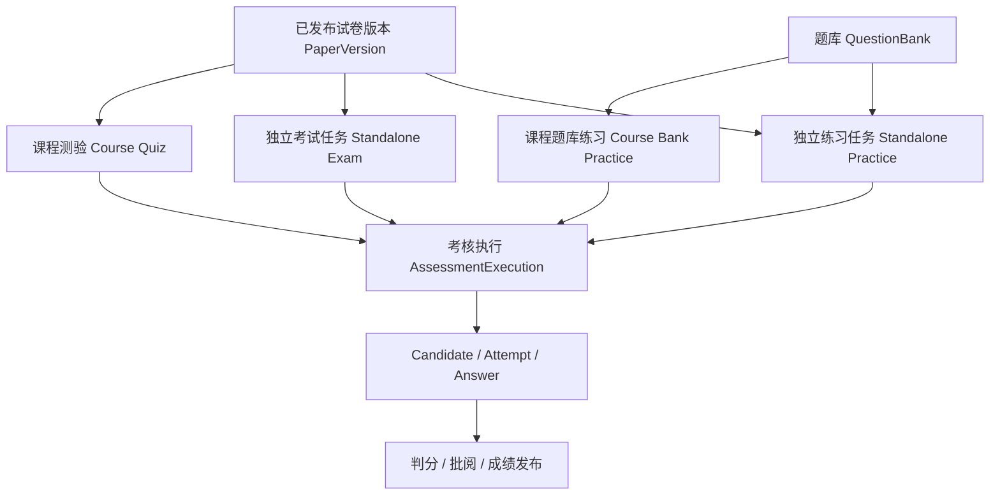

# 课程考核与独立考试分离设计

> 文档状态：课程考核规则已于 2026-08-25 人工确认，设计已收口；实施仍以 OpenSpec Task 授权为准。
>
> 本文是长期架构说明和设计评审材料，不表示已授权修改 API、数据库或业务代码。实施范围、Task 和验收以已确认 OpenSpec Change
> 为准。
>
> 对应 OpenSpec：`openspec/changes/2026-08-25-separate-course-assessment-from-exam/`。

## 1. 设计目的

解决当前“已发布考试”同时承担两种角色的问题：

1. 带考试时间、考试人员、阅卷人和成绩发布规则的独立考试任务。
2. 可被课程章节引用的题库或试卷资源模板。

本设计将题库/试卷资源、课程内容、独立考试任务和作答执行事实分层，使业务语义与《功能项.csv》一致。

## 2. 功能项依据

| 功能项   | 业务要求                      | 设计结论                       |
|-------|---------------------------|----------------------------|
| 14    | 管理员通过题库创建专项训练和题库练习并分配学员   | 属于独立练习任务，不自动成为课程内容类型       |
| 15    | 通过题库、题型、知识点和难度组卷          | 已发布试卷版本是可被多个业务场景引用的资源      |
| 16    | 独立考试设置考试人员、阅卷人、时间、时长和次数   | 考试是一个独立安排的任务，不是课程资源模板      |
| 17    | 客观题自动评分，主观题由阅卷人在线批阅       | 课程和独立考试可共用判分/批阅引擎，但必须区分来源  |
| 22    | 课程章节可添加理论题库和理论试卷测验        | 课程题库直接引用题库，课程测验直接引用已发布试卷版本 |
| 48～49 | “课程学习”与“我的练习/在线考试”是不同学员入口 | 业务任务和结果分开，底层作答能力可共用        |

仿真教学、仿真练习/考试、防作弊和人脸识别已明确延期，不在本设计范围。

## 3. 现状问题

### 3.1 课程引用了错误层级的对象

当前课程 `EXAM / QUESTION_BANK / PRACTICE` 内容项均关联 `examId`。课程编排者不能直接选题库或试卷，而要先创建并发布一个考试任务。

导致：

- 课程测验被显示成“线上考试”。
- 课程题库练习被迫依赖 `BANK_PRACTICE` 考试任务。
- 考试人员、时间、阅卷人和课程报名上下文混在同一对象中。

### 3.2 题库练习执行与数据模型不一致

数据模型已允许题库练习的 `paper_version_id` 为空，并通过 `paper_source_type=QUESTION_BANK` 和
`paper_source_id=questionBankId` 表达来源。

但当前开始作答无条件执行 `requirePaperVersion(exam.getPaperVersionId())`，因此只绑定题库时会报：

> 考试未绑定试卷版本

### 3.3 批阅和成绩的业务归属不清晰

当前主要通过 `examId` 查询候选人、作答、批阅和成绩。虽然 Candidate 中已有课程字段，但课程来源仍是“复用某个考试”的附加上下文，而不是一等业务来源。

## 4. 目标领域模型



关键分工：

| 层次    | 对象                                    | 职责                 |
|-------|---------------------------------------|--------------------|
| 资源层   | 题库、已发布试卷版本                            | 提供题目和不可变版本，可被多场景复用 |
| 业务任务层 | 课程内容项、独立考试/练习                         | 定义谁在什么场景下作答以及结果归属  |
| 执行层   | `AssessmentExecution`                 | 冻结来源、资源和执行规则       |
| 事实层   | Candidate、Attempt、Answer、Review、Score | 记录参与、作答、判分、批阅和结果事实 |

`AssessmentExecution` 是内部执行边界，不是管理员可单独创建的又一种模板。

## 5. 业务来源、行为与资源三维分离

不再用一个 `examType` 同时表达三件事，而是分开保存：

| 维度               | 枚举                                                                           | 回答的问题      |
|------------------|------------------------------------------------------------------------------|------------|
| `sourceType`     | `STANDALONE_EXAM`、`STANDALONE_PRACTICE`、`COURSE_QUIZ`、`COURSE_BANK_PRACTICE` | 结果属于哪个业务场景 |
| `assessmentKind` | `FORMAL_EXAM`、`QUIZ`、`BANK_PRACTICE`、`SPECIAL_PRACTICE`                      | 学员正在完成什么行为 |
| `resourceType`   | `PAPER_VERSION`、`QUESTION_BANK`                                              | 作答题目来自哪类资源 |

业务映射：

| 场景        | 来源                     | 资源      | 结果归属              |
|-----------|------------------------|---------|-------------------|
| 独立在线考试    | `STANDALONE_EXAM`      | 试卷版本    | 独立考试人员和考情统计       |
| 独立专项/题库练习 | `STANDALONE_PRACTICE`  | 试卷版本或题库 | “我的练习”及练习记录       |
| 课程测验      | `COURSE_QUIZ`          | 试卷版本    | 课程报名和课程内容项        |
| 课程理论题库    | `COURSE_BANK_PRACTICE` | 题库      | 课程报名、正确率、错题和内容项进度 |

## 6. 课程内容引用设计

课程新建内容项使用：

```text
ASSET          -> assetId
LIVE           -> liveCourseId/liveSession reference
QUESTION_BANK  -> questionBankId
QUIZ           -> paperVersionId
```

其中：

- `QUESTION_BANK` 直接引用本机构可用题库。
- `QUIZ` 直接引用本机构已发布试卷版本。
- 新建课程题库/测验不再接受 `examId`。
- 课程“专项练习”不在功能项 22 当前范围，不再作为新建课程内容类型。
- 课程发布时必须把资源引用和已确认的执行规则写入课程版本快照。

数据调整：

1. `sts_course_item` 增加可空 `paper_version_id`，仅 `QUIZ` 使用。
2. `QUESTION_BANK` 复用现有 `sts_course_item_question_bank`。
3. 课程目标模型不包含 `EXAM / PRACTICE + examId`；理论作答内容只使用 `QUESTION_BANK` 和 `QUIZ`。
4. 课程版本快照显式增加 `resourceType/resourceId`、资源显示快照和执行规则快照。

## 7. 考核执行对象

增加内部表 `sts_assessment_execution`：

| 字段                                                            | 语义                                   |
|---------------------------------------------------------------|--------------------------------------|
| `assessment_execution_id`                                     | 统一执行主键                               |
| `organization_id`                                             | 业务事实所属机构                             |
| `source_type` / `source_business_id`                          | 课程内容或独立考试来源                          |
| `exam_id`                                                     | 仅独立考试/练习有值                           |
| `course_offering_id` / `course_version_id` / `course_item_id` | 仅课程来源有值                              |
| `assessment_kind`                                             | 正式考试、测验或练习                           |
| `resource_type` / `resource_id`                               | 试卷版本或题库                              |
| `snapshot_schema_version` / `snapshot_json` / `snapshot_hash` | 完整、版本化的冻结执行事实及规范化 SHA-256 摘要         |
| `execution_status`                                            | `DRAFT / READY / CLOSED / CANCELLED` |

唯一边界：

- 独立考试：一个 `examId` 对应一个当前执行对象。
- 课程：一个 `courseOfferingId + courseVersionId + courseItemId` 对应一个执行对象。

课程执行对象在开课发布时幂等生成，便于在学员开始前校验资源、快照和规则。

Candidate、Attempt 和阅卷人关联统一以 `assessment_execution_id` 作为执行归属真相源。`exam_id` 只保留在独立考试任务和
`AssessmentExecution` 的独立考试来源中，不在 Candidate/Attempt/Reviewer 上建立第二套归属。

`snapshot_json` 是来源、资源和执行规则的唯一冻结事实来源。`organization_id`、来源 ID、`assessment_kind`、
`resource_type/resource_id` 仅用于关联、过滤和索引，读取时必须与已经过摘要校验的快照核对。摘要对解析后递归稳定排序的 JSON
语义计算，数组保持业务顺序，小数使用去除无意义尾零的十进制字符串；禁止直接对 Jackson 首次输出或 MySQL 返回文本计算 hash。

执行快照写入后不可原地修改。尚未产生 Candidate、Attempt、Reviewer、结果或冻结题池的执行可以删除后重建；已产生任一执行事实时拒绝刷新。

## 8. 三条执行流程

### 8.1 独立考试

```text
创建独立考试
→ 选择已发布试卷版本
→ 设置时间、考试人员、阅卷人和发布规则
→ 发布并生成 STANDALONE_EXAM 执行对象
→ 学员作答
→ 判分、批阅和发布成绩
→ 进入独立考试人员和考情统计
```

### 8.2 课程测验

```text
课程章节直接选择试卷版本
→ 课程发布冻结资源和规则
→ 开课发布生成 COURSE_QUIZ 执行对象
→ 学员从本人课程报名进入
→ 生成课程来源 Candidate/Attempt
→ 纯客观题交卷判分后自动生效；主观题全部批阅后自动生效
→ 成绩生效后只完成该报名和内容项
```

### 8.3 课程题库练习

```text
课程章节直接选择题库
→ 课程发布冻结题库引用和练习规则
→ 开课发布生成 COURSE_BANK_PRACTICE 执行对象
→ 学员从本人课程报名进入
→ 冻结题库全部可用已发布题目版本
→ 直接冻结作答题目、选项、答案和分值
→ 全部题目至少作答一次并提交后完成一轮
→ 保存答题记录、正确率和错题
```

## 9. 题库练习无试卷版本的处理

题库练习开始时必须根据 `resourceType` 进入独立分支，不能继续统一执行 `requirePaperVersion`。

题库分支的必要事实：

```text
paperVersionId   = NULL
paperSourceType  = QUESTION_BANK
paperSourceId    = questionBankId
```

开始流程：

1. 校验题库属于当前机构且可用。
2. 冻结题库全部可用已发布题目版本。
3. 写入 Attempt 执行参数快照。
4. 写入 AttemptQuestion、Option、正确答案和分值快照。
5. 题库后续修改不影响已创建 Attempt。

题库不存在或没有符合规则的题目时，应返回题库专用错误，不得返回“考试未绑定试卷版本”。

完成一轮的唯一门槛是全部冻结题目至少作答一次并提交，不设置正确率或合格门槛。再次练习追加次数并更新最近、最好、正确率和错题事实，不撤销已完成状态。

## 10. 批阅和成绩来源

底层共用：

- 作答题目/选项快照。
- 答案保存和幂等交卷。
- 客观题自动判分。
- 主观题追加式批阅记录。
- 独立考试成绩发布流水；课程测验保存自动生效事实，不伪造人工发布。

业务入口分开：

| 入口        | 业务条件                                | 允许返回的来源                                 |
|-----------|-------------------------------------|-----------------------------------------|
| 独立考试批阅/成绩 | `examId`                            | `STANDALONE_EXAM / STANDALONE_PRACTICE` |
| 课程测验批阅/成绩 | `courseOfferingId + courseItemId`   | `COURSE_QUIZ`；仅显式配置的执行阅卷人可批阅            |
| 课程题库记录    | `courseEnrollmentId + courseItemId` | `COURSE_BANK_PRACTICE`                  |

教师聚合待办可以合并展示，但每条必须返回：

- `sourceType`、`sourceBusinessId`、`sourceName`。
- 独立考试的 `examId/examName`。
- 课程来源的 `courseId/courseName/courseOfferingId/courseItemId/courseItemTitle`。
- `assessmentExecutionId/candidateId/attemptId`。

课程结果只能按：

```text
assessmentExecutionId + courseEnrollmentId + courseItemId
```

幂等更新课程进度。独立考试使用了同一试卷，也不能自动完成课程测验。

课程测验不进入独立考试人工成绩发布流程：纯客观题交卷判分后自动生效；含主观题时，开课发布前必须在对应执行对象上显式配置至少一名阅卷人，最后一项主观题批阅完成后成绩自动生效。提交但仍待批阅时不得提前完成内容项。

开课继续复用现有完成规则：默认 `ALL_REQUIRED_ITEMS` 只要求 `isRequired=1` 的内容项，`ALL_ITEMS`
要求全部内容项。题库完成一轮、测验最终成绩生效即完成对应内容项；测验仍记录最终分数和 `isPassed`，但本期不以是否合格阻断课程完成。

## 11. API 边界

### 11.1 课程管理

`POST /api/course/items` 及对应更新契约接收互斥的 `questionBankId` 或 `paperVersionId`，不再为新课程题库/测验接收
`examId`。

### 11.2 学员课程作答

课程域提供入口：

```text
POST /api/course/learning/enrollments/{courseEnrollmentId}/items/{courseItemId}/attempts
GET  /api/course/learning/enrollments/{courseEnrollmentId}/items/{courseItemId}/attempts/{attemptId}
```

客户端不得传入 `userId`、`examId`、`questionBankId`、`paperVersionId`、`sourceType` 或课程上下文。服务端从当前登录人、报名、开课和冻结课程版本派生。

学员读取课程作答详情时按自动生效裁剪，不套用独立考试人工发布：

- `RESULT_EFFECTIVE` 且 `resultEffectiveTime` 非空：`scorePublishStatus=EFFECTIVE`、`scoreVisible=true`，返回总分、题目得分、标准答案和解析。
- 作答中或待批阅：`scorePublishStatus=UNPUBLISHED`、`scoreVisible=false`，只回看本人已提交答案。
- 不要求存在 `Exam` / `ExamPolicy`；不向学员返回内部批阅意见。

### 11.3 批阅和成绩

- 独立考试查询、批阅和发布保持在 `/api/exam/**`。
- 课程测验阅卷人配置、结果和批阅放在 `/api/course/**`，内部委托共用判分/批阅服务；课程端不提供人工发布成绩接口。
- 通用 Attempt 详情返回业务来源摘要，并按来源和权限裁剪字段。

实施时必须在 `docs/api/*.openapi.json` 中落地正式 Contract，并满足字段、example、错误码、权限和 Controller tags 规范。

## 12. 权限边界

1. 学员课程作答权限来自本人有效课程报名。
2. 学员独立考试作答权限来自考试人员分配。
3. 同一试卷被课程引用，不会让学员自动获得独立考试权限。
4. 阅卷权限同时校验功能权限、执行来源和阅卷任务归属。
5. 列表、详情、批阅、成绩发布、统计和导出必须使用同一来源过滤，不能只在前端页面区分。

本设计不自行新建权限模型。如现有权限无法表达课程阅卷边界，必须在实施前取得人工确认。

## 13. 最优模型与现有资产复用原则

“不考虑原有数据”是指不为历史数据保留或转换而牺牲业务模型，不等于推倒现有实现。设计和实施应先确定最终模型，再评估现有表、字段和代码能否继续承担该模型中的单一职责：职责一致的直接复用，职责混合的拆分或调整，缺失的能力再新增。

1. 课程理论题库直接引用题库，课程测验直接引用已发布试卷版本。
2. `AssessmentExecution` 是 Candidate、Attempt 和 Reviewer 的唯一执行归属。
3. 课程模型不包含 `EXAM / PRACTICE + examId`，也不存在替代路径或过渡状态。
4. 不设计数据转换、历史数据处理或两套模型并行运行方案。
5. 测试、种子和验收数据均直接按最终模型创建。

现有资产处理如下：

| 现有资产                                  | 处理方向    | 理由                         |
|---------------------------------------|---------|----------------------------|
| 题库、题目版本、试卷及试卷版本                       | 直接复用    | 资源职责正确，与课程或独立考试来源无关        |
| `sts_course_item`                     | 复用并调整   | 继续作为课程内容定义，补充课程测验的试卷版本引用   |
| `sts_course_item_question_bank`       | 直接复用    | 已能表达课程内容项与题库关系             |
| `sts_exam_exam` / `sts_exam_policy`   | 复用      | 继续表达独立考试任务及其安排规则           |
| Candidate、Attempt、题目/选项/答案快照、批阅和发布流水表 | 复用并调整归属 | 作答事实和判分能力可共用，只需统一关联执行对象    |
| `AssessmentExecution`                 | 新增      | 现有对象没有同时适合课程考核和独立考试的中立执行边界 |

实施必须按字段职责、约束和查询成本落实上述边界；不得为了“复用”保留错误语义，也不得为了“全新”重复建设已有正确能力。

每次数据库结构变化必须同时更新 `backend/sts-service-admin-init/src/main/resources/schema/` 中受影响模块的最终完整 SQL，
并在 `backend/sts-service-admin/src/main/resources/db/migration/` 新增同版本 Flyway `V`。空库 init 与上一版本执行增量后必须得到相同
schema，不承担旧业务数据转换职责。

## 14. 方案取舍

### 14.1 推荐：增加内部 `AssessmentExecution`

优点：

- 课程内容和独立考试任务的业务语义清晰。
- Candidate、Attempt、Reviewer 有统一且稳定的归属键。
- 共用作答引擎时不需要伪造隐藏考试或试卷。

代价：

- 需要数据库 migration。
- 需要调整 Candidate/Attempt/Reviewer 的归属关系。
- 课程、考试、Candidate、Attempt 和 Reviewer 需要作为同一完整能力建设。

### 14.2 不推荐：为每个课程内容项创建隐藏考试

这种方案改动较小，但会继续污染独立考试列表、考生、阅卷、成绩和统计语义，未解决根因。

### 14.3 不推荐：只把现有 `exam_id` 改为可空

这可以修复题库开考报错，但 Candidate、Attempt和 Reviewer 仍没有共同的执行归属，后续会继续增加空字段判断和查询特例。

## 15. 已确认的业务规则

1. 课程理论题库冻结全部可用题目，全部至少作答一次并提交即完成一轮，不设置正确率门槛。
2. 纯客观题无需阅卷人；含主观题时在开课对应执行对象上显式配置至少一名阅卷人，否则不得发布开课。
3. 课程成绩自动生效：纯客观题交卷判分后生效，含主观题在全部批阅完成后生效；独立考试继续人工发布。
4. 课程沿用 `ALL_REQUIRED_ITEMS / ALL_ITEMS`；测验成绩生效即完成内容项，保存合格结果但不以合格阻断课程完成。
5. 学员读取课程作答详情按自动生效裁剪：`RESULT_EFFECTIVE` 后可见总分、题目得分、标准答案和解析；待批阅只回看本人已提交答案。不套用独立考试人工发布或
   `ExamPolicy`。

## 16. 验收场景

### 16.1 课程题库

建课直接引用题库 → 发布课程 → 开课 → 冻结全部可用题目 → 学员全部至少作答一次并提交 → 完成一轮并保存正确率和错题。

该链路不需要独立考试，也不需要正式试卷版本。

### 16.2 课程测验

建课直接引用已发布试卷版本 → 发布课程 → 开课 → 学员作答 → 客观题自动生效或主观题批阅后自动生效 → 结果只回写该课程报名。

### 16.3 独立考试

创建考试并选择试卷 → 设置考试人员、阅卷人和时间 → 发布 → 学员作答 → 批阅/成绩发布 → 结果只进入该独立考试的人员和考情统计。

### 16.4 来源隔离

同一学员、同一试卷或题库同时存在于两个课程和一个独立考试时，Candidate、Attempt、答案、批阅、成绩和课程进度均不得串联。
