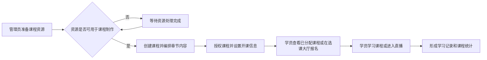
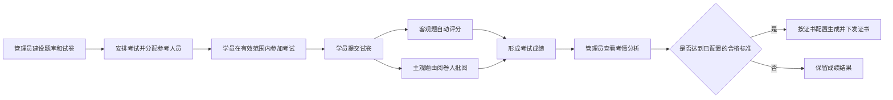
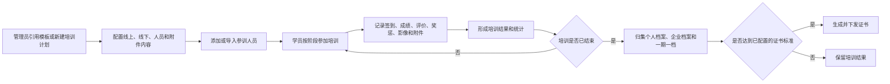

# 安全教育培训需求规格说明书

版本：V1.3  
编制日期：2026-07-21  
原型基线：待确认；需求主基线为《教育培训系统功能功能清单重组.md》，《教育培训功能要求.xlsx》仅用于逐项补缺核对

范围变更记录：2026-07-21，经需求方确认，仿真和人脸识别能力延期，本期不设计、不开发、不测试、不验收。FR-ENT-EXM-009～016、FR-ENT-SYS-006
保留需求编号用于后续追踪，但不属于本期交付范围；FR-ENT-CRS-005、FR-ENT-CRS-006、FR-ENT-TRN-002 本期只实现非仿真部分。后续如重新启动，必须创建独立
OpenSpec Change。

范围变更记录：2026-08-11，经需求方确认，跨机构资源授权能力本期不实施并从系统退役。课程、考试、题库、培训类型、培训标准和培训模板仅允许所属机构使用；本文保留的资源授权
FR 仅用于追溯原始需求，不再作为当前开发或验收依据。后续如重新启动，必须创建独立 OpenSpec Change。

需求澄清记录：2026-09-01，功能项中的“初培学时、复审学时”属于培训类型的两套学时基线；一次培训计划还必须独立选择本次培训性质（初培或复审），
才能确定适用学时并形成发布校验和监管预警。实施设计见待人工确认的 OpenSpec Change `2026-09-01-add-training-plan-nature`。

## 1. 文档目的

本文档定义安全教育培训系统本期建设的业务目标、范围、角色权限、功能结构、核心业务流程、功能需求、业务规则、业务字典和验收基线，作为产品设计、开发、测试和业务验收的共同依据。系统实现方式及其他技术内容不在本文档范围内。

本文档以《教育培训系统功能功能清单重组.md》为主要需求材料，其“企业/培训机构端—学员端—园区监管端”的端别划分及企业/培训机构端“课程—考试—培训—教学辅助—运营分析与统计归档”五大业务模块作为功能结构及需求分组基线；《教育培训功能要求.xlsx》仅用于在上述结构下核对漏项、补充可确认的展示内容和业务规则，不据此改变主材料的功能体系。两份材料无法确认的内容统一标记为“待确认”，Excel“原招标文件”模块最后四项按已确认结论排除。

## 2. 建设目标与范围

安全教育培训系统面向企业/培训机构管理员、老师、学员和园区监管人员，建设覆盖课程、理论考试、培训、教学辅助、运营分析与统计归档、基础支撑、学员学习和园区监管的统一业务平台。系统用于支持企业/培训机构开展课程、理论考试和培训业务，支持学员接收任务并完成学习与考核，支持园区监管人员管理受监管机构、培训标准、预警和全局学习数据。

本期范围包括：

- 企业/培训机构端的课程管理，包括课程资源管理和课程管理（含直播）。
- 企业/培训机构端的考试管理，包括题库管理、试卷管理和理论考试管理。
- 企业/培训机构端的培训管理，包括培训计划模板、培训实施、线下评估、人员和培训结果管理。
- 企业/培训机构端的教学辅助，包括证书管理和问卷调查。
- 企业/培训机构端的运营分析与统计归档，包括考情、课程与培训统计、综合素质评价、专家查课和三级档案管理。
- 企业/培训机构端的基础支撑与系统管理，包括工作台、组织架构、用户账号、角色权限和登录安全。
- 学员端的首页门户、课程学习与选课、练习与在线考试、培训执行和个人中心。
- 园区监管端的监管工作台、受监管机构管理、培训类型与计划模板、预警和学习情况统计。
- 原型页面及 Web、小程序或 App 的最终覆盖范围待确认；本版不据此新增或删减功能。
- Excel 中“原招标文件”模块所列的四项需求不纳入本期范围。
- 仿真软件、仿真教学、仿真练习、仿真考试和人脸识别认证不纳入本期范围，本期不进行产品、技术、数据、接口或页面设计。

## 3. 系统角色与权限

| 角色         | 业务权限                                                                     | 数据范围                                      |
|------------|--------------------------------------------------------------------------|-------------------------------------------|
| 企业/培训机构管理员 | 使用本机构工作台；维护组织、子角色、用户和认证信息；管理课程、考试、培训和教学辅助业务；查看本机构运营分析、统计与档案              | 本企业/培训机构及其被授权组织、资源、人员和业务数据                |
| 老师         | 使用被分配的课程教学、直播、考试负责、阅卷和培训相关功能；具体功能由管理员配置                                  | 被分配的组织、课程、考试、培训和学员数据；跨组织范围待确认             |
| 学员         | 查看本人任务与消息；参加课程、直播、培训、练习和考试；维护个人信息；查看或下载本人证书                              | 本人账号、学习任务、答题记录、成绩、证书及其他个人业务数据             |
| 园区监管人员     | 查看园区监管工作台和预警；管理受监管企业/培训机构；维护培训类型和培训计划模板；查看园区学习情况统计；进入被监管机构管理中心的具体授权范围待确认 | 所监管园区内的企业、培训机构及其汇总数据；进入机构管理中心后可访问的数据范围待确认 |

管理员级、老师级、学生级为材料中明确的角色级别；管理员可创建子角色并分配功能权限和组织管理范围。阅卷人、直播老师和考试负责老师属于业务任务中的人员分配，不作为单独角色。专家查课中的专家是否作为独立登录角色待确认。

## 4. 功能结构

### 4.1 总体功能结构

系统按主需求材料的三个使用端组织功能。企业/培训机构端按课程、考试、培训、教学辅助、运营分析与统计归档五大业务模块以及基础支撑与系统管理组织；学员端围绕接收任务、学习、考试和个人成果组织；园区监管端围绕监管对象、监管标准、预警和统计组织。

```text
安全教育培训
├── 企业/培训机构端
│   ├── 课程
│   │   ├── 课程资源管理
│   │   └── 课程管理（含直播）
│   ├── 考试
│   │   ├── 理论考试管理
│   │   │   ├── 题库管理
│   │   │   ├── 试卷管理
│   │   │   └── 理论考试组织与批阅
│   ├── 培训
│   │   └── 培训计划管理
│   ├── 教学辅助
│   │   ├── 证书管理
│   │   └── 问卷调查
│   ├── 运营分析与统计归档
│   │   ├── 数据统计分析
│   │   ├── 综合素质评价
│   │   ├── 专家查课
│   │   └── 三级档案管理
│   └── 基础支撑与系统管理（管理后台）
│       ├── 企业/培训机构工作台
│       ├── 组织架构管理
│       ├── 用户账号管理
│       ├── 角色权限体系
│       └── 登录与安全管理
├── 学员端
│   ├── 首页门户
│   ├── 课程中心
│   │   ├── 我的课程
│   │   └── 选课大厅
│   ├── 考试练习中心
│   │   ├── 我的练习
│   │   └── 在线考试
│   ├── 培训执行
│   └── 个人中心
└── 园区监管端
    ├── 监管工作台
    │   ├── 数据总览统计
    │   ├── 预警消息中心
    │   └── 功能快捷入口
    ├── 受监管机构管理
    ├── 培训类型管理
    ├── 培训计划模板管理
    └── 企业学习情况统计
```

企业/培训机构工作台及学员登录细节为 Excel 补缺核对后纳入的功能；其余功能树直接沿用主需求材料的端别、层次和功能归属。原型页面清单尚未提供，原型与功能域的逐页对应关系待确认。

| 原型                    | 对应功能域 |
|-----------------------|-------|
| 企业/培训机构端原型页面          | 待确认   |
| 学员端 Web、小程序或 App 原型页面 | 待确认   |
| 园区监管端原型页面             | 待确认   |

### 4.2 按角色划分的功能结构

| 角色         | 功能域      | 主要功能                                  |
|------------|----------|---------------------------------------|
| 企业/培训机构管理员 | 企业/培训机构端 | 课程、考试、培训、教学辅助、运营分析与统计归档、基础支撑与系统管理     |
| 老师         | 企业/培训机构端 | 被分配的课程教学、直播、考试负责、阅卷及其他授权功能            |
| 学员         | 学员端      | 任务和消息、课程与培训学习、练习、在线考试、证书与个人信息         |
| 园区监管人员     | 园区监管端    | 数据总览、培训计划预警、机构管理、培训类型、培训计划模板和企业学习情况统计 |

## 5. 核心业务流程

### 5.1 课程发布与学习流程



### 5.2 理论考试流程



### 5.3 延期能力说明

仿真和人脸识别能力本期不设计、不实施，因此不定义本期业务流程。后续如重新启动，应在独立 OpenSpec Change
中重新确认业务流程、外部协议、安全与合规要求。

### 5.4 培训实施与归档流程



### 5.5 培训标准配置与预警流程


## 6. 功能需求说明

### 6.1 企业/培训机构端

#### 6.1.1 课程

| 需求编号           | 功能       | 要求                                                                            |
|----------------|----------|-------------------------------------------------------------------------------|
| FR-ENT-CRS-001 | 课程资源管理   | 支持批量上传、下载和删除文档、音频、视频及图片等课程资源，上传成功的资源可在线预览。                                    |
| FR-ENT-CRS-002 | 课程资源处理状态 | 上传资源后进行转码；转码中的资源不可下载、编辑或用于课程制作，转码成功后方可执行上述操作。转码失败状态及处理方式待确认。                  |
| FR-ENT-CRS-003 | 课程创建     | 管理员可根据教学目标或教学任务创建课程，维护课程概况、教学目标、教学大纲和考核方式，并向学员展示课程基本信息。                       |
| FR-ENT-CRS-004 | 课程目录     | 课程内容按章节编排，支持创建无限级目录结构。                                                        |
| FR-ENT-CRS-005 | 课程内容编排   | 本期课程章节可挂载知识点、理论题库、测验和直播课程；知识点资源支持 Word、Excel、PDF、PPT、图片、音频和视频等格式。仿真练习和仿真考试延期。 |
| FR-ENT-CRS-006 | 章节学习记录   | 本期理论题库章节记录答题情况、正确率和错题；测验章节记录每题答题情况及最终成绩。仿真练习和仿真考试记录延期。                        |
| FR-ENT-CRS-007 | 课程授权     | 支持将公共课程和内部课程授权给组织，授权权限分为仅查看或可编辑删除；授权后组织可使用课程进行开课。                             |
| FR-ENT-CRS-008 | 开课管理     | 管理员可设置开课时间、结束时间、开课类型和合格方式；学员可在课程中心查看被授权的课程并学习。                                |
| FR-ENT-CRS-009 | 学习详情     | 管理员可查看已学习课程的学员上课详情；具体展示字段待确认。                                                 |
| FR-ENT-CRS-010 | 直播课程     | 管理员可创建直播课程，设置直播名称、时间、老师、链接和参与范围，可复制链接分享；学员可通过学员端直播课程卡片进入学习。                   |

#### 6.1.2 考试

##### 6.1.2.1 理论考试管理

| 需求编号           | 功能          | 要求                                                                        |
|----------------|-------------|---------------------------------------------------------------------------|
| FR-ENT-EXM-001 | 题库管理        | 企业/培训机构管理员可创建和管理题库，题库按平台公共内容和机构内部内容划分；题目可设置知识点和难易度，支持判断题、单选题、多选题、填空题和简答题。 |
| FR-ENT-EXM-002 | 题目资源与批量处理   | 题目可添加图片、视频等资源；支持通过 Excel 批量导入和导出题目。导入模板、校验规则和失败处理方式待确认。                   |
| FR-ENT-EXM-003 | 试卷组卷        | 管理员可按题库、题型、知识点和难度固定抽题或随机抽题，可设置不同题型的题目数量、分值和多题库占比。                         |
| FR-ENT-EXM-004 | 试卷随机与预览     | 试卷支持题目顺序随机；管理员编辑试卷后可实时预览并更换试题。随机规则和换题范围待确认。                               |
| FR-ENT-EXM-005 | 专项训练与题库练习配置 | 管理员可基于题库创建专项训练和题库练习并分配给学员，供学员进行专业能力练习和错题练习。                               |
| FR-ENT-EXM-006 | 理论考试安排      | 管理员可安排在线考试，按班级分配参考人员或导入参考学员名单，并设置阅卷人、有效时间段、有效时长和有效次数等信息。                  |
| FR-ENT-EXM-007 | 理论考试资源授权    | 支持将已设置的公共或内部题库、试卷及考试授权给机构内部组织；不同资源的可授权权限范围待确认。                            |
| FR-ENT-EXM-008 | 理论考试成绩批阅    | 学员提交试卷后，客观题由系统自动评分，主观题由阅卷人在线批阅；批阅界面展示试题、学员答案和标准答案。                        |

##### 6.1.2.2 仿真考试（延期，本期不设计、不实施）

FR-ENT-EXM-009～016 保留需求编号供后续追踪，不计入本期设计、开发、测试和验收范围。

| 需求编号           | 功能     | 要求                                                                                                        |
|----------------|--------|-----------------------------------------------------------------------------------------------------------|
| FR-ENT-EXM-009 | 仿真软件库  | 支持维护 APP、WebGL、UnityPlayer、exe 等形式的仿真软件安装包，展示名称、ID、开发商、专业分类、描述、存储路径、操作文档、演示视频和软件示意图等属性，并支持下载、安装和启动的一键化操作。 |
| FR-ENT-EXM-010 | 仿真试卷   | 管理员可创建固定题目或随机题目的仿真试卷。题目结构、随机范围和计分规则待确认。                                                                   |
| FR-ENT-EXM-011 | 仿真资源分配 | 管理员可选择已分配给本机构的试卷、仿真软件和课程并分配给组织；组织可查看被分配的资源。                                                               |
| FR-ENT-EXM-012 | 仿真考试创建 | 管理员可基于仿真试卷创建仿真考试，设置考试有效时间、总分、合格成绩、考试负责老师和考试人员范围，并分配给组织。                                                   |
| FR-ENT-EXM-013 | 仿真考试提醒 | 仿真考试创建成功后向参考学员发送考试通知，并在考试前24小时再次发送提醒。                                                                     |
| FR-ENT-EXM-014 | 仿真练习分配 | 管理员可将已授权的仿真软件分配给组织人员进行练习，学员可执行软件的下载、安装和启动。                                                                |
| FR-ENT-EXM-015 | 仿真成绩明细 | 管理员可查看学员仿真考试和仿真练习成绩，包括各操作步骤得分，并可导出成绩明细。                                                                   |
| FR-ENT-EXM-016 | 仿真记录查询 | 支持查询独立仿真练习和课程内仿真练习记录，可按姓名或账号、软件 ID、软件名称、项目名称、分数范围和开始时间范围筛选，并导出查询结果。                                       |

#### 6.1.3 培训

| 需求编号           | 功能     | 要求                                                                             |
|----------------|--------|--------------------------------------------------------------------------------|
| FR-ENT-TRN-001 | 培训计划模板 | 管理员可按工种或培训类型创建并引用培训计划模板，模板包含名称、关联培训类型和培训内容。                                    |
| FR-ENT-TRN-002 | 培训模板内容 | 本期培训模板可配置理论题库、测验、理论考试、课程和线下培训阶段；线下培训可配置签到、考核成绩导入和培训地点。仿真练习和仿真考试延期。             |
| FR-ENT-TRN-003 | 培训计划实施 | 管理员可维护培训基本信息，并分别选择培训类型和本次培训性质（初培或复审）；可维护线上培训、线下培训、培训人员和附件资料，并按培训计划添加阶段内容和培训详情。 |
| FR-ENT-TRN-004 | 培训资料   | 支持上传培训过程中产生的影像、培训附件、奖惩评价和综合评价等资料。                                              |
| FR-ENT-TRN-005 | 线下培训评估 | 展示线下培训课堂考试内容，支持记录线下签到和导入线下培训考核成绩；相关统计分析在运营分析与统计归档模块中查看。                        |
| FR-ENT-TRN-006 | 培训人员管理 | 支持查看参训人员，通过单个添加、批量导入或学员扫码注册账号三种方式加入培训，并可导出培训名单。                                |
| FR-ENT-TRN-007 | 培训结果   | 已结束培训可查看培训计划整体信息、学员培训详情和成绩、奖惩信息及本次培训结果；培训统计在运营分析与统计归档模块中查看。                    |

#### 6.1.4 教学辅助

| 需求编号           | 功能      | 要求                                                                          |
|----------------|---------|-----------------------------------------------------------------------------|
| FR-ENT-AUX-001 | 证书模板设计  | 管理员可使用图片作为证书模板底图，在模板中配置证书编号、学员姓名等内容；模板编辑后可生成对应样式的证书供在线查看或下载。除已列内容外的模板变量待确认。 |
| FR-ENT-AUX-002 | 证书配置与下发 | 证书可关联理论考试、课程或培训；业务对象达到已配置的合格标准后，系统按配置生成并下发相应证书。                             |
| FR-ENT-AUX-003 | 证书查询    | 企业/培训机构管理员可进行证书管理；学员可在个人中心查看或下载本人已获得的证书。                                    |
| FR-ENT-AUX-004 | 问卷设计    | 支持自主设计问卷题目和答案，对问卷进行查看、编辑、复制和删除，并预览手机模式和电脑模式。                                |
| FR-ENT-AUX-005 | 问卷使用    | 已创建问卷可用于线下培训调查或学员对培训机构的评价；培训中可发起问卷，学员可扫码填写，结果及统计数据的查看范围由管理员设置。              |

#### 6.1.5 运营分析与统计归档

| 需求编号           | 功能       | 要求                                                                                                        |
|----------------|----------|-----------------------------------------------------------------------------------------------------------|
| FR-ENT-OPS-001 | 理论考试成绩列表 | 管理员可查看当次考试的学员成绩列表和成绩统计信息，并可批量导出成绩。                                                                        |
| FR-ENT-OPS-002 | 考情分析     | 支持展示完成率、应考人数、参考人数、最高分、平均分、最低分、成绩分段人数及占比、题型占比、题型正确率、成绩排名、参考时间、考试时长、错题 TOP5、缺考，以及平台、操作系统、浏览器等环境统计；各指标口径待确认。 |
| FR-ENT-OPS-003 | 课程统计     | 支持按单个课程和个人查看参与情况、参与时长和知识点掌握度，并可生成统计图片供下载；指标口径待确认。                                                         |
| FR-ENT-OPS-004 | 培训统计     | 按参加培训计划的班级进行整合分析，区分线上培训和线下培训展示，并支持饼图、条形图等图表；统计口径待确认。                                                      |
| FR-ENT-OPS-005 | 综合素质评分表  | 支持在线设置综合素质评分表、表单规则和综合分数，培训管理可引用已设置的评分表。                                                                   |
| FR-ENT-OPS-006 | 综合素质评分   | 系统可根据奖惩或考试成绩自动计算综合素质得分；具体项目、权重、加减分和计算公式待确认。                                                               |
| FR-ENT-OPS-007 | 专家查课     | 支持新建和管理专家查课表，记录专家查课意见，用于课程质量监督和改进；培训管理可引用已创建的查课表。                                                         |
| FR-ENT-OPS-008 | 个人档案     | 支持查询个人档案详情，展示个人培训记录、参训情况、奖惩记录和综合评价，并支持导出档案记录及查看、下载证书。                                                     |
| FR-ENT-OPS-009 | 企业档案     | 支持按企业名称查询企业档案，按培训名称、培训编号、开始时间、结束时间或培训类型筛选培训计划；详情展示培训计划、参训人员、签到、成绩、奖惩、影像记录、附件和统计等内容，支持更新和下载档案。             |
| FR-ENT-OPS-010 | 一期一档     | 汇集所有已结束培训形成培训档案，展示培训计划、企业列表、参训人员、签到、成绩、综合评价、奖惩、影像记录、附件和统计等内容，并支持档案下载。                                     |

#### 6.1.6 基础支撑与系统管理（管理后台）

| 需求编号           | 功能         | 要求                                                                                    |
|----------------|------------|---------------------------------------------------------------------------------------|
| FR-ENT-SYS-001 | 企业/培训机构工作台 | 管理员可在工作台查看本机构的数据分析内容和功能入口，并进入权限范围内的管理功能；工作台具体指标待确认。                                   |
| FR-ENT-SYS-002 | 组织架构管理     | 支持创建无限级组织节点，可使用学校、学院、专业、系、班级等组织类型；管理员可新增、修改、删除组织节点并设置所属父机构。                           |
| FR-ENT-SYS-003 | 角色权限管理     | 管理员可创建子角色，为子角色分配功能权限和组织管理范围。系统区分管理员级、老师级和学生级，角色级别越高权限越大，默认角色为管理员、老师、学生；各级别的完整权限清单待确认。 |
| FR-ENT-SYS-004 | 用户账号管理     | 支持新增、删除和编辑用户信息，按用户名、姓名等属性模糊查询；支持按单组织或多组织通过 Excel 批量导入、导出用户账号。                         |
| FR-ENT-SYS-005 | 登录与安全管理    | 支持账号密码登录和微信绑定一键登录；小程序端支持数字安全验证。登录失败、解绑及重新绑定规则待确认。                                     |
| FR-ENT-SYS-006 | 认证中心配置     | 延期需求：考试、培训和课程的人脸识别配置及学员认证信息管理，本期不设计、不实施、不验收。                                          |

### 6.2 学员端

| 需求编号       | 功能      | 要求                                                         |
|------------|---------|------------------------------------------------------------|
| FR-LRN-001 | 账号密码登录  | 学员可使用账号密码登录；小程序端支持数字安全验证。数字安全验证方式和触发条件待确认。                 |
| FR-LRN-002 | 微信绑定与登录 | 学员可将微信与平台账号绑定，并通过微信一键登录。解绑及重新绑定规则待确认。                      |
| FR-LRN-003 | 首页门户    | 首页展示已分配给学员的考试、课程等学习任务；培训任务是否作为独立首页卡片展示待确认。                 |
| FR-LRN-004 | 系统消息    | 学员可接收实时提醒、任务提醒、考试通知和培训通知，并查看与本人相关的消息。                      |
| FR-LRN-005 | 我的课程    | 按进行中、未开始、已结束和已过期查看分配给本人的理论课程列表。                            |
| FR-LRN-006 | 课程学习    | 学员可查看课程详情、课程目录、课程报告和课程评价，并按章节学习；直播课程可通过课程卡片进入。             |
| FR-LRN-007 | 选课大厅    | 学员可按课程名称和课程分类筛选开放课程并报名，报名成功后可学习。课程开放条件和退选规则待确认。            |
| FR-LRN-008 | 培训执行    | 学员可按培训计划状态查看本人培训列表，按阶段查看并学习本期培训内容、查看附件资料；培训计划状态值待确认。       |
| FR-LRN-009 | 线下培训参与  | 学员可参加线下培训签到并参与培训评价；签到方式和有效条件待确认。                           |
| FR-LRN-010 | 专项训练    | 展示分配给学员的专项训练，支持查看全部题目、未做题目、错题、收藏、答题卡，并清除练习记录。              |
| FR-LRN-011 | 题库练习    | 展示分配给学员的题库练习，支持查看全部题目、未做题目、错题、收藏和答题卡，进行模拟考试，清除练习记录并更换练习模式。 |
| FR-LRN-012 | 在线考试    | 按待参加、未完成、已完成三种状态展示在线考试；学员可进入当前允许参加的考试并提交答卷。各状态的进入和退出条件待确认。 |
| FR-LRN-013 | 个人中心    | 学员可完善个人信息、查看或下载证书、绑定微信和修改密码；可维护的个人信息字段待确认。                 |

### 6.3 园区监管端

| 需求编号       | 功能       | 要求                                                                                              |
|------------|----------|-------------------------------------------------------------------------------------------------|
| FR-REG-001 | 数据总览统计   | 园区监管人员可在工作台查看全园区企业数据、培训情况、培训类型、特种作业培训情况、培训机构信息和企业培训人员等统计内容；各统计指标的计算口径待确认。                       |
| FR-REG-002 | 预警消息中心   | 园区监管人员可查看待查看预警消息和培训计划预警列表。系统根据计划选择的初培或复审性质，读取培训类型对应学时基线，并与实际培训计划比较；计划学时不满足适用最低要求时形成预警，预警数据支持导出。 |
| FR-REG-003 | 功能快捷入口   | 工作台提供证书管理、课程制作和数据中心等快捷入口；数据中心可进入企业或培训机构数据大屏，并支持查看二级数据界面。二级界面的具体内容待确认。                           |
| FR-REG-004 | 受监管机构管理  | 支持按机构分类创建受监管企业或培训机构，并支持查看、编辑、授权和管理；选择“管理”后可进入对应机构的管理中心，进入后的具体操作权限和数据范围待确认。                      |
| FR-REG-005 | 培训类型管理   | 支持按工种添加和查看培训类型。培训类型展示名称、标签、图片、初培学时、复审学时和线上培训学时最高占比等内容；平台内置不少于25种特种作业人员培训类型。                     |
| FR-REG-006 | 培训计划模板管理 | 支持建立多级培训计划模板分类，并按工种或培训类型维护标准化模板；企业或培训机构可引用模板快速建立实际培训计划。                                         |
| FR-REG-007 | 企业学习情况统计 | 展示监管范围内企业的员工账号数、上课次数、上课人数、参与课程数、人均上课次数和参与率等信息，供园区监管人员查看企业学习情况；统计口径待确认。                          |

## 7. 核心业务规则

### 7.1 权限与数据范围

- 管理员创建子角色时同时分配功能权限和组织管理范围；角色只能访问被授予的功能和组织范围内的数据。
- 园区监管人员默认访问所监管园区的企业、培训机构和汇总统计；进入具体机构管理中心后的权限边界待确认。
- 老师只处理被分配的课程、直播、考试、阅卷或培训任务；跨组织访问规则待确认。
- 学员只查看和处理本人任务、学习记录、成绩、证书和个人信息。

### 7.2 课程与考试资源及授权

- 课程资源处于转码中时，不可下载、编辑或用于课程制作；转码成功后方可执行上述操作。
- 题库按平台公共和机构内部划分；课程分为公共课程和内部课程。试卷和考试材料中也存在公共、内部范围，具体归属维护方式待确认。
- 课程授权权限包括“仅查看”和“可编辑删除”；其他资源的授权权限类型待确认。

### 7.3 考试与证书

- 理论考试客观题自动评分，主观题由阅卷人手动批阅，二者共同形成考试成绩。
- 在线考试列表状态统一为待参加、未完成、已完成；状态进入、退出和补考时的流转规则待确认。
- 证书关联理论考试、课程或培训；达到对应业务配置的合格标准后生成并下发证书。合格标准的优先级和重复发证规则待确认。

### 7.4 培训、评价与档案

- 培训计划可引用培训模板，本期模板可组合题库、测验、理论考试、课程和线下培训阶段。
- 培训类型表达工种或作业类别；培训性质表达一次计划属于初培还是复审，两者不得混用。培训计划创建或修改时必须选择初培或复审，模板不预先绑定培训性质。
- 初培计划使用培训类型的初培学时，复审计划使用复审学时。已发布培训标准的 `TOTAL_HOURS`
  可以提高但不能降低该基线；计划发布时冻结最终适用最低学时，来源后续修改不回写历史计划。具体字段、历史兼容和接口契约以待确认
  OpenSpec Change `2026-09-01-add-training-plan-nature` 为准。
- 培训人员可通过单个添加、批量导入或扫码注册账号三种方式加入培训。
- 综合素质得分可依据奖惩或考试成绩自动计算；计算项目、权重、加减分和异常值处理规则待确认。
- 已结束培训进入培训结果查看范围，并归集到个人档案、企业档案和一期一档；档案更新时点和锁定规则待确认。

### 7.5 统计指标口径

| 指标                | 口径                                                                                           |
|-------------------|----------------------------------------------------------------------------------------------|
| 培训计划学时预警          | 按计划培训性质选择培训类型初培或复审学时；再叠加不能降低该基线的培训标准要求并冻结适用最低学时。监管检测以冻结值为基线，规则条件可收紧但不得降低；线上占比独立按培训类型和标准上限校验。 |
| 完成率               | 待确认                                                                                          |
| 平均分、最高分、最低分       | 统计对象、缺考人员是否纳入及成绩版本取值规则待确认                                                                    |
| 成绩分段人数及占比         | 分段边界和分母范围待确认                                                                                 |
| 题型占比、题型正确率        | 题目和作答的统计范围待确认                                                                                |
| 错题 TOP5           | 错题统计对象、排序规则和并列处理待确认                                                                          |
| 课程参与情况、参与时长、知识点统计 | 有效参与、有效时长和知识点掌握度的计算规则待确认                                                                     |
| 人均上课次数、参与率        | 人员范围、课程范围和统计周期待确认                                                                            |
| 线上培训、线下培训统计       | 统计对象、分类规则和图表口径待确认                                                                            |
| 综合素质得分            | 奖惩和考试成绩的取值、权重及计算公式待确认                                                                        |

## 8. 业务字典

### 8.1 角色级别

| 编码  | 名称   |
|-----|------|
| 待确认 | 管理员级 |
| 待确认 | 老师级  |
| 待确认 | 学生级  |

### 8.2 题目类型

| 编码  | 名称  |
|-----|-----|
| 待确认 | 判断题 |
| 待确认 | 单选题 |
| 待确认 | 多选题 |
| 待确认 | 填空题 |
| 待确认 | 简答题 |

### 8.3 课程内容类型

| 编码  | 名称   |
|-----|------|
| 待确认 | 知识点  |
| 待确认 | 理论题库 |
| 待确认 | 测验   |
| 待确认 | 直播课程 |

### 8.4 课程开课类型

| 编码  | 名称 |
|-----|----|
| 待确认 | 选修 |
| 待确认 | 必修 |

### 8.5 学员课程状态

| 编码  | 名称  |
|-----|-----|
| 待确认 | 进行中 |
| 待确认 | 未开始 |
| 待确认 | 已结束 |
| 待确认 | 已过期 |

### 8.6 在线考试状态

| 编码  | 名称  |
|-----|-----|
| 待确认 | 待参加 |
| 待确认 | 未完成 |
| 待确认 | 已完成 |

### 8.7 课程资源转码状态

| 编码  | 名称   |
|-----|------|
| 待确认 | 转码中  |
| 待确认 | 转码成功 |

### 8.8 资源归属范围

| 编码  | 名称   |
|-----|------|
| 待确认 | 平台公共 |
| 待确认 | 机构内部 |

### 8.9 课程授权权限

| 编码  | 名称    |
|-----|-------|
| 待确认 | 仅查看   |
| 待确认 | 可编辑删除 |

### 8.10 延期能力字典

仿真软件类型和人脸识别相关字典本期不设计。后续启动相应 OpenSpec Change 时重新定义，不沿用未确认枚举。

## 9. 验收基线

- 企业/培训机构端、学员端和园区监管端的本期功能均可在交付系统中找到对应入口；原型页面基线确认后，应补充逐页对应关系。
- 企业/培训机构管理员、老师、学员和园区监管人员只能访问其功能权限及数据范围内的内容。
- 课程学习、理论考试、培训归档和培训标准预警等本期核心流程可按本文档描述完整执行。
- 题目和用户账号的批量导入导出、资源和附件的上传预览、名单和成绩等材料明确要求的导出能力可正常使用。
- 客观题自动评分、主观题人工批阅、培训结果和证书下发能够形成对应业务结果。
- FR-ENT-EXM-009～016、FR-ENT-SYS-006 以及混合 FR 中的仿真部分不纳入本期验收。
- 材料中列明的考试、课程、培训和监管统计内容可查看；已确认口径的统计结果可根据业务明细复核，未确认口径须在验收前完成确认。
- 已结束培训可形成个人档案、企业档案和一期一档，并可查看材料明确列明的培训、人员、签到、成绩、评价、奖惩、影像和附件内容。

## 10. 需求变更规则

原型、本文档及后续设计、开发、测试和验收材料应通过唯一的 FR-* 需求编号建立关联。需求发生变更时，应先更新对应 FR-*
条目，并评估其对建设范围、角色权限、数据范围、功能结构、核心流程、业务规则、业务字典和验收基线的影响。原型页面基线确认后，应补充原型与功能域的对应关系；任何新增功能或范围调整均须经过确认后纳入本文档。
