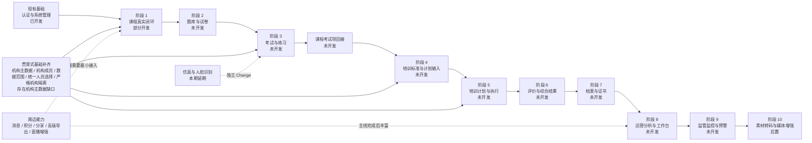

# 安全教育培训系统端到端开发路线图

编制日期：2026-07-24

状态盘点日期：2026-07-27

## 1. 文档目的

本文把现有业务设计、角色流程和代码实施现状整理成一条可连续执行的开发主线。路线从当前已经启动的课程域继续推进，先完成素材与课程基础
CRUD 和可执行课程闭环，再依次建设考试、培训、结果、档案、证书、分析和监管预警，最后实施素材转码与媒体增强。

本文是长期开发顺序和依赖说明，不代替具体业务能力的 OpenSpec Change、API Contract、Task 或验收记录，也不承诺日历工期。

主要依据：

- `docs/requirement/role-workflows.md`：各角色实际要执行的端到端业务流程。
- `docs/requirement/business-process.md`：标准、计划、学习、考试、档案、证书和预警的业务顺序。
- `docs/requirement/functional-modules.md`、`business-baseline.md`：业务范围与能力边界。
- `docs/product/安全教育培训需求规格说明书.md`：本期功能需求与延期范围。
- `docs/architecture/business-architecture.md`、`domain-model.md`：领域依赖与边界。
- 已归档的数据模型设计、课程域 OpenSpec、正式 migration、OpenAPI、前后端代码和自动化测试。

## 2. 路线原则

1. **主线优先。** 优先打通“管理员组织业务 → 学员执行 → 教师处理 → 结果沉淀”的纵向闭环，不按页面数量或后端表数量宣布完成。
2. **依赖优先。** 先建设会被下游引用的定义和事实，再建设聚合、档案和预警；监管预警必须接入稳定的业务事实，素材转码作为最终媒体增强后置实施。
3. **课程先行。** 先把素材基础 CRUD 和已经开发到一半的课程能力补成可执行闭环，再进入题库和考试，不同时铺开多个未闭环业务域。
4. **契约先行。** 每阶段遵循“OpenSpec → 人工确认 → API Contract → migration → 前后端实现 → 测试与 Review → QA / Retro”。
5. **多端同一业务切片。** 管理端、教师任务端、学员 PC/移动端和后端属于同一个业务能力，不拆成互不验收的独立终点。
6. **事实先于统计。** 学习会话、答卷、批阅、签到、成绩计算、归档版本等事实必须稳定、可追溯，之后才能开发工作台、统计和预警。
7. **权限随业务同步。** 功能权限、数据范围、业务任务归属和本人执行链必须随每个阶段一起验收，不能在系统末期补做。
8. **周边延后丰富。** 素材转码、消息渠道、积分、分享、复杂报表和高级证书能力等只保留主线所需的接口边界，完整能力在核心闭环完成后补充。
9. **素材先 CRUD、后转码。** 当前只要求素材元数据、文件关联、查询、新增、修改、删除、启停用和删除保护；转码供应商、异步作业、派生文件、在线媒体预览和失败恢复不阻塞阶段
   1。

## 3. 状态标记与完成口径

| 标记        | 含义                                 | 判定口径                                                                         |
| ----------- | ------------------------------------ | -------------------------------------------------------------------------------- |
| ✅ 已开发   | 当前范围已形成可验证实现             | 正式 migration、后端/API、目标端页面和相关测试均已落地；没有关键 Mock 或占位阻断 |
| 🟡 部分开发 | 已有设计或部分代码，但业务闭环不完整 | 任一关键层缺失，或仍依赖默认 Mock、桩服务、占位页面、单机构临时方案              |
| ⬜ 未开发   | 只有需求或已评审设计                 | 没有正式 migration、对应后端/API 和可用业务页面                                  |
| ⏸ 延期     | 已明确不属于本期                     | 本期不设计、不开发、不测试；重新启动时必须新建独立 OpenSpec Change               |

以下内容**不等于已开发**：

- 归档 OpenSpec 中用于评审的数据模型草稿 DDL。
- 菜单、路由或空白页面已经存在，但没有业务交互。
- 前端仅能使用内存 Mock 完成演示。
- 后端只有状态桩或单机构临时实现，尚未接入真实外部服务和数据权限。
- 单层代码完成，但角色之间没有形成真实任务交接。

## 4. 总体规划图



主线业务结果逐步演进为：

```text
M1 课程闭环
管理员建课并开课 → 学员真实学习 → 管理员查看学习事实

M2 课程与考试闭环
建题组卷 → 安排考试 → 学员作答 → 教师批阅 → 发布成绩 → 回接课程

M3 培训执行闭环
标准/模板 → 培训计划 → 课程/考试/线下执行 → 参训结果

M4 培训成果闭环
正式综合结果 → 归档 → 证书 → 学员个人成果

M5 监管闭环
稳定业务事实 → 统计分析 → 标准比对 → 预警 → 处置留痕

M6 素材媒体增强
素材 CRUD → 转码任务 → 派生文件/预览 → 失败恢复与监控
```

## 5. 当前实施状态总览

### 5.1 端到端能力盘点

| 能力                                                                     | 数据与后端                                                                                              | API Contract                                  | 管理端                               | 学员/教师端                                      | 当前结论                                      |
| ------------------------------------------------------------------------ | ------------------------------------------------------------------------------------------------------- | --------------------------------------------- | ------------------------------------ | ------------------------------------------------ | --------------------------------------------- |
| 登录、用户、部门、角色、菜单、字典及系统管理                             | 已有后端实现和系统表                                                                                    | `system-admin.openapi.json` 已有            | PC 页面已开发                        | PC/移动端本地登录与基础布局已开发                | ✅ 已开发                                     |
| 机构主数据、机构成员、标签岗位、角色数据范围、统一人员选择与严格机构隔离 | 成员、标签岗位、数据范围、统一人员选择和租户隔离已有后端；机构仅有`DEFAULT` 占位表记录，无主数据 CRUD | 机构成员/人员选择契约已有；机构 CRUD 契约待补 | 机构主数据及相关基础页面由前端另开   | 无                                               | 🟡 部分开发：缺少真实机构登记册               |
| 素材基础 CRUD                                                            | 正式 migration、后端 CRUD、启停用和删除保护已开发                                                       | `asset.openapi.json` 已有                   | 素材库页面已开发，但默认走 Mock      | 无                                               | 🟡 部分开发：后端已完成，真实 CRUD 联调待完成 |
| 素材转码与媒体派生                                                       | 已有转码任务表和桩实现，尚无真实供应商、异步作业和派生处理                                              | 已有部分状态与任务接口                        | 仅有任务查看与重试入口               | 无学习预览/播放页                                | 🟡 部分开发：明确后置到阶段 10                |
| 课程分类、设置、课程定义、章节、素材/直播内容编排                        | 正式 migration、后端、权限和测试已开发；知识点/题库/考试类内容项仍禁用                                  | `course.openapi.json` 已有                  | PC 管理页面已开发，但默认走 Mock     | 学员课程页仍为占位                               | 🟡 部分开发                                   |
| 课程版本、开课、报名、学习会话、进度与评价                               | 正式 migration、后端、API 和测试已开发                                                                  | 已覆盖版本、开课、报名和学习接口              | 版本、开课、名单和学习详情页面已开发 | 学员 PC/移动学习入口、播放器和进度上报页面未开发 | 🟡 部分开发                                   |
| 题库、知识点、题目版本与试卷                                             | 只有已评审数据模型草稿，无正式 migration 和业务代码                                                     | 无                                            | 无                                   | 无                                               | ⬜ 未开发                                     |
| 考试、练习、补考、作答、批阅与成绩发布                                   | 只有已评审数据模型草稿，无正式 migration 和业务代码                                                     | 无                                            | 考试入口为占位或未配置               | PC/移动考试页为占位                              | ⬜ 未开发                                     |
| 培训类型、标准、模板、计划、参训与线下执行                               | 只有已评审数据模型草稿，无正式 migration 和业务代码                                                     | 无                                            | 培训入口未形成业务页面               | 培训入口为占位                                   | ⬜ 未开发                                     |
| 问卷、评价表单与综合成绩计算                                             | 只有已评审数据模型草稿                                                                                  | 无                                            | 无                                   | 无                                               | ⬜ 未开发                                     |
| 个人/机构/期次档案与证书                                                 | 只有已评审数据模型草稿                                                                                  | 无                                            | 无                                   | 学员首页证书卡片仅为占位                         | ⬜ 未开发                                     |
| 工作台、运营分析、监管统计与预警                                         | 只有需求和数据模型设计                                                                                  | 无                                            | 首页指标为占位                       | 无                                               | ⬜ 未开发                                     |
| 仿真软件、仿真练习/考试、人脸识别                                        | 本期明确不落表、不开发                                                                                  | 无                                            | 无                                   | 无                                               | ⏸ 延期                                       |

### 5.2 课程阶段状态说明（2026-07-24 更新）

**后端（lims 口径）：** 素材基础 CRUD、课程编排、版本/开课/报名/学习事实/评价 API、统一人员选择和严格机构隔离已落地；进度表 *
*M1
已按后端口径关闭**（见 `engineering/qa/2026-07-24-m1-course-backend-close.md`）。跨机构资源授权已于 2026-08-11 退役。

**前端另开（不阻塞 lims M1）：**

1. PC 管理端默认 Mock / 真实联调（COURSE-06）。
2. 学员 PC / 移动学习页（COURSE-07/08）。
3. `KNOWLEDGE_POINT`、`QUESTION_BANK`、`EXAM`、`PRACTICE` 内容项仍等题库与考试阶段回接。

素材转码仍后置阶段 10，不阻塞 M1。不得把桩转码标记为真实转码完成。

## 6. 分阶段开发路线

### 阶段 1：完成课程真实闭环

**当前状态：后端 ✅ 已按 lims 口径关闭；前端联调/学员端 ⏸ 另开。**

**目标：** 把现有课程管理代码从“管理端可演示”推进到“管理员和学员可使用的真实课程闭环”（后端 API + OpenAPI 已交付；前端页面由非 lims 协作方按契约实施）。

#### 1.1 先补主线硬依赖

- 完成机构主数据登记册，能够先创建真实园区、企业和培训机构，再建立部门、成员及严格机构边界；`DEFAULT`
  只保留历史兼容，不得继续代表真实机构。
- 完成机构成员和最小可用数据范围，替换只有默认机构的临时边界。
- 使用全员、部门或指定人员进行当次选择，最终在课程报名或开放报名白名单中保存具体用户；直播继承课程报名资格。
- 保证课程仅允许所属机构查看、引用和管理，不提供跨机构资源授权。
- 保持素材能力在基础 CRUD 范围，只完成元数据、文件关联、查询、新增、修改、删除、启停用和删除保护的真实接口；不在本阶段开发转码。

#### 1.2 完成管理端真实联调

- 关闭默认 Mock，逐项联调素材基础 CRUD、分类、设置、课程、编排、版本、开课、报名和学习详情。
- 对齐基础文件关联与素材元数据 CRUD 的边界；转码任务、派生文件和在线媒体预览不进入本阶段。
- 验证真实登录、功能权限、机构隔离、数据范围、乐观锁和删除保护。
- 联调通过后删除生产路径中的课程与素材 Mock 分支，测试夹具可保留在测试目录。

#### 1.3 完成学员课程执行端

- 建设 PC 和移动端的我的课程、选课大厅、课程详情与目录。
- 建设不依赖转码的文档素材和直播入口；音视频转码、派生播放和相关学习控制在阶段 10 补充。
- 接入自助报名、退选、断点续学、学习会话幂等上报、内容项进度、完成判定和课程评价。
- 建设学员课程结果页；管理员端可从同一事实查看名单、总进度、分项进度和学习会话。

#### 1.4 阶段完成门槛

必须通过以下真实链路，才可标记课程为“✅ 已开发”：

```text
管理员创建并维护基础素材
→ 课程引用可用且不依赖转码的素材
→ 创建并发布课程版本
→ 创建开课并圈定学员
→ 学员 PC/移动端进入并学习
→ 学习会话与进度正确落库
→ 课程完成结果生成
→ 管理员查看同一份学习事实
```

同时完成权限、机构隔离、幂等、异常恢复和课程回归测试。课程考试类内容项不在本阶段强行实现，继续保持禁用；素材转码不属于本阶段完成门槛。

### 阶段 2：题库与试卷资源

**当前状态：⬜ 未开发。**

**前置：** 阶段 1 的素材基础 CRUD、机构权限和严格机构隔离稳定。

按依赖顺序实施：

1. 知识点树、题库分类与题库定义。
2. 判断、单选、多选、填空、简答五类题目及选项/答案/关键词。
3. 题目图片、音视频等素材只完成基础文件关联和 Excel 导入校验，不在本阶段引入转码处理。
4. 题目不可变版本，旧考试引用的版本不可覆盖。
5. 固定、随机和自定义试卷及不可变试卷版本。
6. 组卷规则校验、预览、换题和结果可重现测试。
7. 题库、题目和试卷严格按所属机构隔离。

阶段完成结果是“管理员能够建设一套可发布、可复盘且仅供本机构使用的理论考试内容资源”，但此时还不能宣布考试闭环完成。

### 阶段 3：考试、练习、批阅与成绩发布

**当前状态：⬜ 未开发。**

**前置：** 阶段 2；机构成员、统一人员选择和教师任务归属可用。

按学员实际考试顺序实施：

1. 创建在线考试、线下考试、专项练习和题库练习，冻结试卷/题库和考试规则。
2. 圈定参考人员、导入名单、指定负责人和阅卷人，冻结人员档案快照。
3. 发布考试并在 PC/移动端生成学员任务。
4. 开始作答时冻结题目、选项、分值、时长、题序和计分规则。
5. 实现答案暂存、幂等交卷、超时交卷和基础防作弊事件。
6. 客观题自动判分；主观题进入被指派阅卷人的待办。
7. 批阅与改分只追加记录，完成后进入待发布状态。
8. 发布正式成绩，并实现补考新尝试、题库练习重置和错题状态。
9. 建设学员成绩页、教师阅卷页、管理员考情明细。
10. 回接课程中的 `QUESTION_BANK`、`EXAM`、`PRACTICE` 内容项，把考试结果纳入课程完成判定。

阶段完成链路：

```text
建题组卷 → 安排考试 → 学员作答 → 自动判分/教师批阅
→ 管理员发布成绩 → 学员查成绩 → 课程读取本课程上下文成绩
```

同一考试被课程、培训或独立任务复用时，候选人、尝试和成绩必须按业务上下文隔离。

### 阶段 4：培训标准、模板与计划输入

**当前状态：⬜ 未开发。**

**前置：** 多机构严格隔离可用；课程与考试已经是本机构可发布资源。

本阶段先建设培训计划的上游输入：

1. 园区与企业/培训机构监管关系及有效期。
2. 不少于 25 种正式培训类型的稳定编码与幂等初始化；每种类型维护初培学时、复审学时和线上最高占比。
3. 总学时、线上占比、指定课程、指定考试、线下要求等培训标准；标准总学时可以收紧但不得降低培训类型基线。
4. 培训模板分类、阶段和内容；模板发布后形成可引用版本。
5. 园区向企业/培训机构授予 VIEW、USE、MANAGE 权限和有效期。
6. 评价表单定义与不可变版本，为培训计划绑定评价口径提供前置输入。

阶段完成结果是“园区可以提供标准和模板，企业能够在有效监管关系与授权下选择使用”，但还没有实际培训执行。

### 阶段 5：培训计划与线上线下执行

**当前状态：⬜ 未开发。**

**前置：** 阶段 1、3、4 全部完成。

按计划生命周期实施：

1. 分别选择培训类型和本次培训性质（初培或复审），引用标准/模板或独立创建计划；按性质确定最低学时，复制模板内容并冻结来源、规则快照和哈希。
2. 编排阶段和课程、考试、线下场次；绑定固定评价表单版本。
3. 按指派、导入或扫码加入形成参训人员，并冻结必要人员信息。
4. 发布计划，按计划内容幂等生成开课、考试和线下执行实例。
5. 学员在统一培训任务中进入课程、考试和线下阶段。
6. 向教师分配直播、线下授课和线下评分任务。线下签到确认本期不做。
7. 线下最小交付为公示地点并录入考核成绩；签到、签退、迟到、请假、缺勤、附件和奖惩本期不做。
8. 把课程、考试和线下成绩准确回写到对应参训人和计划内容。

阶段完成链路：

```text
标准/模板 → 建计划 → 圈人发布 → 生成课程/考试/线下实例
→ 学员执行 → 教师处理 → 参训人获得完整分项结果
```

### 阶段 6：问卷、评价与综合结果

**当前状态：⬜ 未开发。**

**前置：** 阶段 5 已产生稳定的课程、考试和线下事实。

实施顺序：

1. 问卷定义、不可变版本、投放实例和具体参与人员绑定；结果可见性由业务权限与机构隔离控制。
2. 学员作答、匿名展示脱敏、防重复提交和统计。
3. 专家查课、人员评价、课程质量评价等被指派任务。
4. 培训课程、考试、线下成绩和奖惩的来源明细归集。
5. 按计划确定的权重和同类型聚合方式生成不可变综合成绩批次。
6. 人工确认正式批次；重算只能新增批次并替代旧批次。
7. 建设学员培训结果、管理员结果确认和来源追溯页面。

阶段完成结果是“每名参训人拥有一份来源可解释、历史不可覆盖的正式培训结果”。

### 阶段 7：三级档案与证书

**当前状态：⬜ 未开发。**

**前置：** 阶段 3 的正式考试成绩或阶段 6 的正式培训结果。

先归档、后形成长期成果：

1. 以计划、人员、课程、考试、签到、评价、成绩和附件为来源生成归档快照。
2. 形成个人档案、企业/机构档案和一期一档三个查询视角。
3. 归档封存后不可覆盖；更新档案只能产生新版本并保留旧版本哈希。
4. 建设证书模板、模板版本、元素和课程/考试/培训签发规则。
5. 达标后自动或人工幂等签发证书，保存模板版本和内容快照。
6. 实现学员查看/下载、管理员查询，以及撤销和人工重发留痕。

档案与证书都读取已确认结果，不能各自重新计算成绩或使用页面临时口径。

### 阶段 8：运营分析、工作台与业务丰富

**当前状态：⬜ 未开发。**

**前置：** 课程、考试、培训、综合结果和档案事实稳定。

优先建设可以从明细反查的指标：

- 企业/培训机构工作台：待办、课程、考试、培训执行和结果概览。
- 学员首页：待学、待考、培训任务、学习时长、成绩、档案和证书。
- 教师任务中心：直播、线下授课、签到确认、阅卷和评价。
- 课程统计、考情统计、培训统计和综合素质分析。
- 个人、部门、机构、计划和期次维度的筛选、下钻与导出。
- 消息提醒、站内信、积分、分享和直播体验增强。

统计查询必须先应用与明细一致的数据范围再聚合；列表、详情、统计、导出和异步任务不得各自实现不同权限口径。

### 阶段 9：园区监管监控与预警

**当前状态：⬜ 未开发。**

**前置：** 阶段 4 的标准和监管关系，以及阶段 5～8 的稳定执行事实与指标口径。

这是监管主线的最后阶段，实施顺序如下；完成后再进入阶段 10 的素材媒体增强。

1. 园区监管工作台和被监管机构列表。
2. 从培训、课程、考试、结果和档案事实生成监管查询投影。
3. 监管统计、机构对比和逐级下钻。
4. 配置透明的指标、比较符和阈值预警规则。
5. 按检测周期执行规则，使用确定性 `dedup_key` 幂等生成预警。
6. 保存触发规则、来源事实和证据快照。
7. 建设查看、分派、处理中、关闭、忽略等处置流水。
8. 验证监管关系失效、数据范围变化和并发调度下的数据隔离与幂等。

必须能够从每一条预警下钻到原始计划、人员、学习、成绩或档案事实；无法解释来源的聚合指标不得用于预警。

### 阶段 10：素材转码与媒体增强

**当前状态：🟡 部分开发，明确后置。**

**前置：** 阶段 9 和 M5 完成；素材基础 CRUD 已稳定；存储、转码供应商和容量成本获得人工确认。

最后实施：

1. 明确可转码文件类型、大小限制、存储保留、供应商和失败重试策略。
2. 接入真实异步转码任务、回调验签、状态流转和幂等处理。
3. 生成并管理派生文件，补齐在线预览、音视频播放和下载边界。
4. 处理超时、失败、重试、人工恢复和原文件/派生文件一致性。
5. 把音视频播放、快进、倍速、水印和有效学习时长接回课程学习端。
6. 建设任务监控、错误审计、容量指标和目标回归测试，关闭 M6。

阶段 10 开工前必须新建并确认独立 OpenSpec Change；当前转码桩只可用于测试和接口占位，不能作为实现基础直接宣布完成。

## 7. 贯穿主线的基础能力

以下能力不能全部等到最后补做，但应按当前阶段最小需要逐步落地：

| 基础能力                 | 首次必须可用的阶段   | 后续扩展                                                      |
| ------------------------ | -------------------- | ------------------------------------------------------------- |
| 机构、成员与角色数据范围 | 阶段 1               | 阶段 4 保持监管视图与业务资源机构边界分离                     |
| 统一人员选择             | 阶段 1 开课          | 阶段 3 考试、阶段 5 培训、阶段 6 问卷复用；最终均保存具体人员 |
| 严格机构隔离             | 阶段 1 课程          | 阶段 2 题库/试卷、阶段 4 标准/模板继续沿用                    |
| 通用导入批次             | 阶段 2 题目导入      | 阶段 3 考生、阶段 5 参训人和线下成绩复用                      |
| 消息与任务提醒           | 阶段 1 最小通知      | 阶段 8 丰富渠道、模板和消息中心                               |
| 操作审计与不可变流水     | 阶段 1 起            | 考试批阅、成绩、归档、证书和预警逐步加强                      |
| 文件与素材               | 阶段 1 完成基础 CRUD | 各业务复用文件关联；阶段 10 再实现转码、派生和媒体预览        |
| 幂等与事件触发           | 阶段 1 学习会话      | 成绩发布、综合计算、归档、证书签发和预警复用                  |

## 8. 暂不进入主线的能力

### 8.1 本期延期

- 仿真软件库、仿真试卷、仿真练习和仿真考试。
- APP、WebGL、UnityPlayer、exe 等仿真运行协议。
- 人脸识别认证及其防作弊事件。

这些能力保持“⏸ 延期”，不得为了预留而创建本期生产表、API 或占位业务规则。重新启动时必须创建独立 OpenSpec
Change，并重新确认跨端运行、安全和成绩回传协议。

### 8.2 主线完成后再丰富

- 素材转码、派生文件、在线预览、音视频播放和失败恢复（阶段 10）。
- 多渠道消息、复杂积分运营和公开分享。
- 直播互动、录播、回放和更复杂的有效时长策略。
- 高级综合成绩公式、缺勤否决、封顶保底和条件组合。
- 证书签章、防伪、复杂编号、自动重发。
- 自定义监管指标表达式和复杂 SLA。
- 非主线的大屏、装饰性报表和重复统计页面。

如某项周边能力成为当前阶段的真实硬依赖，应在该阶段 OpenSpec 中只纳入可验收的最小能力。

## 9. 推荐的近期执行顺序

从当前代码状态继续开发时，建议严格按以下顺序启动，不并行铺开考试或培训页面：

1. **课程闭环缺口确认。** 关闭素材基础 CRUD、学习完成口径、具体报名人员、多机构权限和多端边界的待确认事项；转码明确排除。
2. **课程真实联调。** 关闭默认 Mock，完成素材基础 CRUD 与课程管理端对后端的真实契约、权限和异常联调。
3. **学员课程纵向切片。** 先交付“我的课程 → 进入一个内容项 → 上报一次学习会话 → 管理端看到进度”的最小切片，再扩展完整材料类型、完成规则和评价。
4. **课程阶段验收。** 完成 PC、移动端、后端、数据库、权限和回归测试，形成 M1。
5. **再启动题库与试卷 OpenSpec。** 题目版本和试卷版本稳定后，进入考试执行与课程考试项回接，形成 M2。
6. **转码保持后置。** 阶段 1～9 未完成前，不启动素材转码和媒体派生实现；完成 M5 后再建立阶段 10 的独立 Change。

## 10. 每阶段统一完成清单

每个阶段只有同时满足以下条件才能从“部分开发/未开发”更新为“已开发”：

- 已确认的 OpenSpec Task 全部完成，未越界实现后续阶段。
- API Contract 包含 URL、方法、请求、响应、错误码、权限和示例，并与调用方一致。
- 数据变化全部使用正式 migration，设计草稿 DDL 不直接执行。
- 管理端、教师任务端和学员端中属于本阶段的角色链路均可真实执行。
- 功能权限、数据范围、业务任务归属和本人执行链通过测试。
- 状态机、快照、幂等、逻辑删除、并发和异常恢复通过目标测试。
- 列表、详情、统计、导出读取同一事实和数据权限口径。
- Mock、桩和占位若仍存在，已明确不在生产路径且不阻断验收。
- 相关 docs/API、OpenSpec Task 状态、QA 和 Retro 已同步。
- 规格符合性与代码质量双轴 Review 结论均为“通过”。

## 11. 路线图维护规则

- 每完成一个 OpenSpec Task，只更新对应能力的状态和证据，不提前把整个阶段标为完成。
- 出现 API Contract、权限、数据库或架构边界变化时，先更新对应 OpenSpec 和长期文档，再调整本路线图。
- 新增统计或预警前，必须在本路线图中标明它依赖的原始事实和指标口径。
- 本文的“当前状态”应在每个阶段验收后更新；代码目录、正式 migration、OpenAPI 和自动化测试是状态判断的主要证据。
