# 分角色业务流程梳理

编制日期：2026-07-23

## 1. 目的与依据

本文基于已评审通过的数据模型设计与现有 DDL，把系统各角色从头到尾的业务流程梳理成文，供后端实施、API Contract
设计和测试用例编写时对齐口径。

依据：

- `openspec/changes/archive/2026-07-22-design-safety-training-mysql-schema/design.md`：全量数据模型设计（130 张新表，两轮评审通过）。
- `backend/sts-service-admin-init/src/main/resources/schema/schema-*.sql`：init 最新完整 DDL；
  `backend/sts-service-admin/src/main/resources/db/migration/V*.sql`：Admin 增量真相源。
- `docs/requirement/user-roles.md`、`business-process.md`、`business-development-roadmap.md`、`course-module-task-plan.md`。

本文只梳理业务顺序与责任交接，不代替状态机、API Contract 或数据库事务设计；标注"暂定"的环节以后续 OpenSpec 确认为准。

## 2. 角色模型说明

> **口径变更（2026-08-07，多租户改造）**
>
> 本文成文于 2026-07-23，当时的可见性模型是"机构树 + 角色数据范围"。
> `2026-08-06-rebuild-multi-tenant-isolation` 已把它整体替换为扁平多租户：
>
> - 每个企业是一个租户，租户之间完全隔离，可见范围由 MyBatis-Plus 租户插件在 SQL 层强制注入；
> - `data_scope`、`us_sys_role_dept`、`sts_org_member`、`sts_org_regulatory_relation` 均已删除；
> - 登录改为"企业编码 + 工号 + 密码"；
> - 监管平台是唯一的 `REGULATOR` 租户，无条件覆盖全部企业租户，只读。
>
> 下文中涉及机构层级、角色数据范围与监管关系的描述以本说明为准。

先明确一个关键设计口径：**系统中没有硬编码的"教师""学员"角色表**。角色分两层：

| 层          | 载体                                             | 说明                                                                                                                                                                                                                    |
|------------|------------------------------------------------|-----------------------------------------------------------------------------------------------------------------------------------------------------------------------------------------------------------------------|
| 系统 RBAC 角色 | `us_sys_role`（租户内定义）+ `us_sys_role_menu`（功能权限） | 回答"能不能操作"；**可见范围不再由角色表达**，由租户隔离在 SQL 层强制（见下方口径变更）；各租户可自行配置"培训管理员""教务老师"等角色                                                                                                                                            |
| 业务任务归属     | 业务表上的明确关系字段                                    | 回答"这件事归谁"：直播讲师 `sts_course_live_session.teacher_user_id`、阅卷人 `sts_exam_reviewer`、线下讲师 `sts_training_offline_session.teacher_user_id`、计划负责人 `sts_training_plan.manager_user_id`、学员报名 `sts_course_enrollment.user_id` 等 |

即使拥有菜单权限，教师也只能处理被分配的任务，学员只能访问本人执行链；`superAdmin`（账号编码严格相等）是唯一的硬编码特权。

本文按业务视角划分五类角色梳理流程：

1. 平台超级管理员 / 机构系统管理员
2. 园区监管端（监管员）
3. 企业/培训机构管理员（含资源建设、培训组织、结果管理职责）
4. 教师（讲师 / 阅卷人 / 评价人，业务任务归属角色）
5. 学员

## 3. 平台超级管理员 / 机构系统管理员：基础支撑流程

> 实施状态：系统管理模块已实施。机构成员档案（`sts_org_member`）与角色数据范围（`data_scope`/`us_sys_role_dept`）
> 已随多租户改造删除，见下方口径变更。

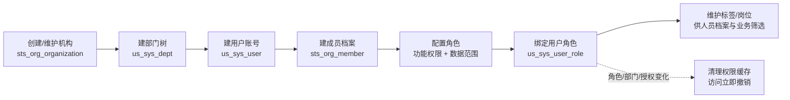

| 步骤 | 操作       | 涉及表                                   | 关键规则                                                                                  |
|----|----------|---------------------------------------|---------------------------------------------------------------------------------------|
| 1  | 创建/维护机构  | `sts_org_organization`                | 机构类型 PLATFORM/PARK/ENTERPRISE/TRAINING_INSTITUTION；机构编码全局唯一                           |
| 2  | 维护机构内部门树 | `us_sys_dept`                         | 父子部门必须同机构；机构内部门编码唯一                                                                   |
| 3  | 创建用户账号   | `us_sys_user`、`us_sys_auth_identity`  | 一个账号只有一个主部门（`dept_id`），只属于一个主要机构；支持批量导入（`sts_common_import_batch`，business_type=USER） |
| 4  | 建机构成员档案  | `sts_org_member`                      | 保存工号、岗位等培训扩展档案；不复制姓名/部门/角色                                                            |
| 5  | 配置角色     | `us_sys_role`、`us_sys_role_menu`      | 角色编码租户内唯一；角色只表达功能权限，不再配置数据范围                                                          |
| 6  | 绑定用户角色   | `us_sys_user_role`                    | 强制校验用户部门与角色属于同一机构                                                                     |
| 7  | 标签/岗位维护  | `sts_org_tag`、`sts_org_position` 及关联表 | 供人员档案和其他业务筛选使用；统一业务选人仅支持全员、部门、指定人员                                                    |

角色、部门、用户部门、角色菜单任一变化后必须清理权限缓存；停用账号/角色后培训业务访问随缓存失效立即撤销。

## 4. 园区监管端：标准与监管流程

> 实施状态：全部为已评审设计，待实施（路线图阶段 7 + 培训模块阶段 4 的标准部分）。

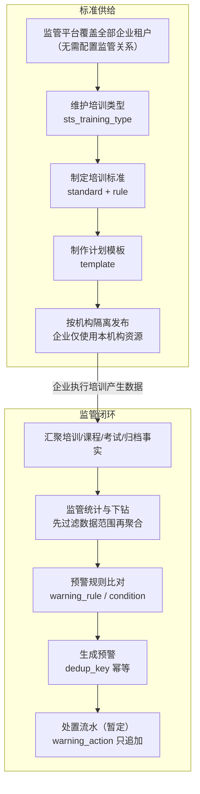

| 步骤 | 操作         | 涉及表                                                  | 关键规则                                                             |
|----|------------|------------------------------------------------------|------------------------------------------------------------------|
| 1  | —（监管关系已取消） | —                                                    | 监管平台租户无条件覆盖全部启用中的企业租户；下钻明细通过 `X-Target-Tenant-Id` 切换视角，每次访问记审计日志 |
| 2  | 维护培训类型     | `sts_training_type`                                  | 实施阶段内置不少于 25 种正式类型（type_code 稳定、初始化幂等）                           |
| 3  | 制定培训标准     | `sts_training_standard`、`sts_training_standard_rule` | 规则类型：总学时/线上占比/指定课程/指定考试/线下要求                                     |
| 4  | 制作计划模板     | `sts_training_template` 及分类/阶段/内容表                   | 模板只是创建计划的输入，引用后复制，不回写                                            |
| 5  | 企业使用本机构资源  | 培训类型、标准与模板业务表                                        | 资源所属机构必须与当前机构一致；创建计划时冻结来源快照                                      |
| 6  | 查看监管统计     | 从培训/课程/考试/归档事实表聚合                                    | 不建重复明细表；统计先过滤数据范围再聚合                                             |
| 7  | 配置预警规则     | `sts_regulation_warning_rule`、`_condition`           | 只支持透明的指标阈值比较（LT/LE/EQ/GE/GT）                                     |
| 8  | 接收并处置预警    | `sts_regulation_warning`、`_evidence`、`_action`       | 按检测周期 dedup_key 幂等生成；处置只追加流水；SLA/关闭权限暂定                          |

## 5. 企业/培训机构管理员：核心业务流程

这是流程最长的角色域，按四条主线梳理。

### 5.1 素材与课程主线（上传素材 → 创建课程 → 发布 → 开课）

> 实施状态：**已实施**（素材库、课程配置与编排、发布版本、开课与学习，见 openspec archive 的 4 个 implement-course-* Change）。

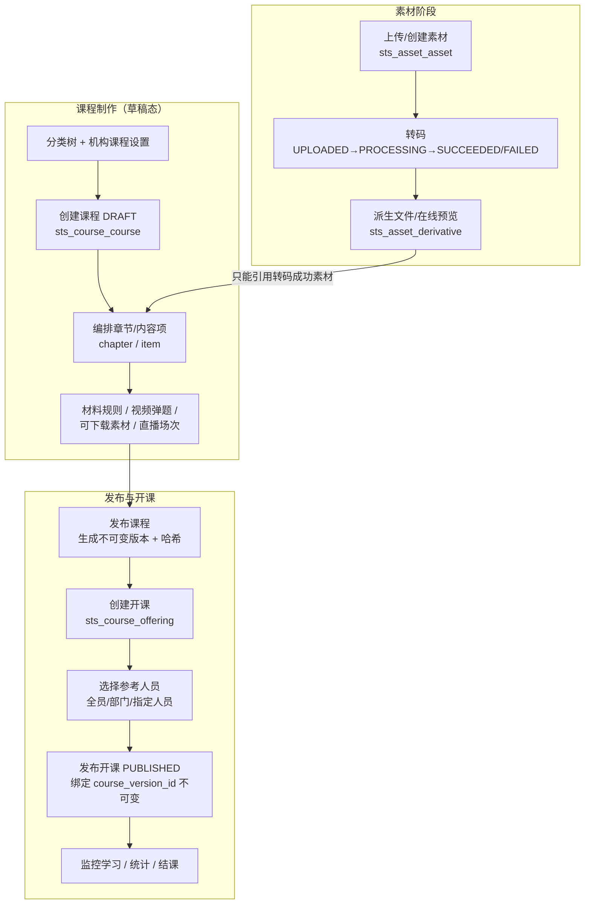

**素材阶段：**

| 步骤 | 操作      | 涉及表                                              | 关键规则                                                                         |
|----|---------|--------------------------------------------------|------------------------------------------------------------------------------|
| 1  | 上传/创建素材 | `sts_asset_asset`（文件本体在 `us_sys_file_info`）      | 类型 DOCUMENT/IMAGE/AUDIO/VIDEO/RICH_TEXT/LINK/LIVE；来源 UPLOAD/CREATED/EXTERNAL |
| 2  | 转码处理    | `sts_asset_transcode_job`、`sts_asset_derivative` | 状态机 UPLOADED→PROCESSING→SUCCEEDED/FAILED；转码中不可下载/编辑/用于课程                     |
| 3  | 素材管理    | 同上                                               | 删除前按 `idx_asset` 做反向引用检查，被课程/题目引用的素材只能停用                                     |

**课程制作阶段（草稿态）：**

| 步骤 | 操作           | 涉及表                                                              | 关键规则                                                                              |
|----|--------------|------------------------------------------------------------------|-----------------------------------------------------------------------------------|
| 4  | 维护课程分类       | `sts_course_category`                                            | 机构内树形，同层同名唯一                                                                      |
| 5  | 创建课程         | `sts_course_course`、`sts_course_course_category`                 | 编码机构内唯一；SINGLE/MULTI_CHAPTER 两种内容模式；publish_status 从 DRAFT 开始                     |
| 6  | 编排章节         | `sts_course_chapter`                                             | 业务层强制两层（课程→章节→内容项），parent_id 固定 0                                                 |
| 7  | 编排内容项        | `sts_course_item` 及知识点/题库关联表                                     | 类型 ASSET/KNOWLEDGE_POINT/QUESTION_BANK/EXAM/PRACTICE/LIVE；考试类三种当前禁用，待题库/考试模块交付后回接 |
| 8  | 配置学习时长与视频弹题 | `sts_course_item.minimum_study_seconds`、`sts_course_item_video_question` | ASSET 要求学习时长必须大于 0，其他类型固定为 0；倍速与文档水印只由课程级设置控制；只能引用转码 SUCCEEDED 的素材              |
| 9  | 配置可下载素材、直播场次 | `sts_course_download_asset`、`sts_course_live_session`            | 直播场次 1:1 绑定内容项，指定讲师 `teacher_user_id`                                             |

**发布与开课阶段：**

| 步骤 | 操作      | 涉及表                                                           | 关键规则                                                                                            |
|----|---------|---------------------------------------------------------------|-------------------------------------------------------------------------------------------------|
| 10 | 发布课程    | `sts_course_version` + `sts_course_course.current_version_id` | 事务内生成递增 version_no + 完整 JSON 快照 + 哈希；发布幂等；版本只读；再次修改草稿后重新发布产生新版本                                 |
| 11 | 创建开课    | `sts_course_offering`                                         | 必修/选修（course_type）与报名渠道（enrollment_type：ASSIGNED/OPEN/LINK）正交；完成规则 ALL_REQUIRED_ITEMS/ALL_ITEMS |
| 12 | 选择参考人员  | `sts_exam_candidate`                                          | 全员/部门/指定人员当次展开，最终逐人保存考生事实                                                                       |
| 13 | 发布开课    | `sts_course_offering.publish_status`                          | DRAFT→PUBLISHED 时绑定当时的 current_version_id，之后不可变；后续 ENDED/CANCELLED                              |
| 15 | 监控学习与统计 | `sts_course_enrollment`、`_item_progress`、`_study_session`     | 列表/详情/统计/导出走同一数据范围；统计先过滤再聚合                                                                     |

### 5.2 题库考试主线（建题库 → 组卷 → 办考试 → 发成绩）

> 实施状态：已评审设计，待实施（路线图阶段 3）。

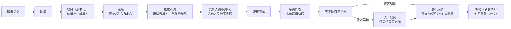

| 步骤 | 操作       | 涉及表                                                                    | 关键规则                                                                          |
|----|----------|------------------------------------------------------------------------|-------------------------------------------------------------------------------|
| 1  | 维护知识点、题库 | `sts_question_knowledge_point`、`sts_question_bank` 等                   | 题库可关联知识点，供抽题与错题分析                                                             |
| 2  | 录入/导入题目  | `sts_question_question`、`sts_question_version` 及选项/填空/关键词表             | 题目身份与版本分离；编辑产生新版本，旧版本只读；导入走 `sts_common_import_batch`（business_type=QUESTION） |
| 3  | 组卷       | `sts_paper_paper`、`sts_paper_version`、`_version_question`/`_draw_rule` | 固定/自定义卷写死题目，随机卷写抽题蓝图；编辑产生新试卷版本                                                |
| 4  | 创建考试     | `sts_exam_exam`、`sts_exam_policy`                                      | 类型 ONLINE/OFFLINE/SPECIAL_PRACTICE/BANK_PRACTICE；线上考试发布须绑定明确 paper_version_id |
| 5  | 安排人员与阅卷人 | `sts_exam_candidate`、`sts_exam_reviewer`                               | 分配时冻结人员档案快照；候选人按（考试+用户+业务上下文）唯一                                               |
| 6  | 批阅       | `sts_exam_answer`、`sts_exam_review_record`                             | 客观题自动评分；人工题进入 PENDING_REVIEW；每次评分/改分追加记录不覆盖                                   |
| 7  | 发布成绩     | `sts_exam_score_publish_log`                                           | 发布后才更新候选人正式结果并幂等触发积分/证书/消息；通知如启用仅面向该考试实际考生                                    |
| 8  | 补考/练习重置  | `sts_exam_attempt`、`sts_exam_practice_reset`                           | 补考是新尝试 attempt_no 递增；练习重置只在该考试人员下生效                                           |

考试状态机（设计已确认）：

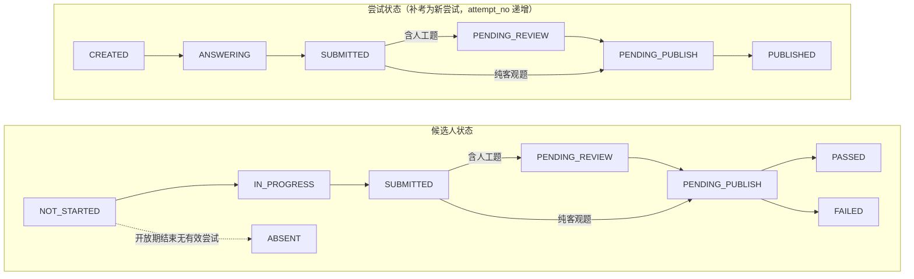

### 5.3 培训计划主线（选标准 → 建计划 → 执行 → 综合成绩 → 归档）

> 实施状态：已评审设计，待实施（路线图阶段 4～5）。

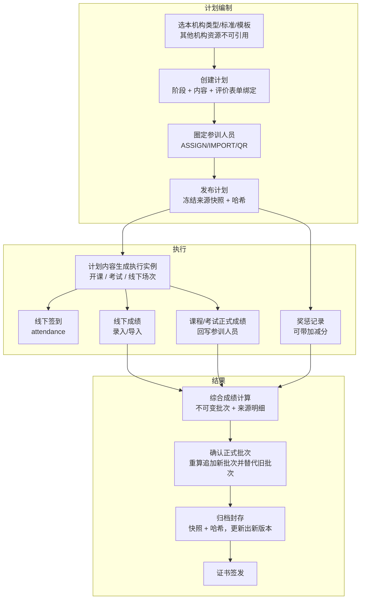

| 步骤 | 操作          | 涉及表                                                       | 关键规则                                                                              |
|----|-------------|-----------------------------------------------------------|-----------------------------------------------------------------------------------|
| 1  | 创建培训计划      | `sts_training_plan`、`_stage`、`_content`                   | 引用模板后复制；类型、标准和模板必须属于当前机构，并冻结来源快照                                                  |
| 2  | 绑定评价表单      | `sts_training_plan_evaluation_form`                       | 每种用途（综合/专家/人员/课程质量）只绑一个固定表单版本                                                     |
| 3  | 圈定参训人员      | `sts_training_participant`                                | 来源 ASSIGN/IMPORT/QR；导入走公共导入批次；扫码加入须先建账号和机构成员                                      |
| 4  | 发布计划、生成执行实例 | `plan_content → course_offering / exam / offline_session` | 执行实例保存 plan_content_id 溯源；结果链 `plan_content → 执行实例 → 执行人员 → training_participant` |
| 5  | 线下执行        | `sts_training_offline_session`、`_attendance`              | 讲师、地点、签到规则；签到方式与迟到阈值暂定                                                            |
| 6  | 线下成绩        | `sts_training_offline_score`                              | 手工录入或导入（business_type=OFFLINE_SCORE）                                              |
| 7  | 奖惩与评价       | `sts_training_reward_penalty`、`_participant_evaluation`   | 奖惩可带分数变化，参与综合成绩加减分                                                                |
| 8  | 综合成绩计算      | `sts_evaluation_calculation_run`、`_source`                | 每次计算生成不可变批次；重算追加新批次并替代旧正式批次；只有 CONFIRMED+official 的批次是正式结果                        |
| 9  | 归档          | `sts_archive_training`、`_version`、`_participant`、`_asset` | 封存冻结快照+哈希；"更新档案"生成新版本不覆盖旧版本；支持个人/机构/期次三视角导出                                       |

### 5.4 证书与问卷主线

> 实施状态：已评审设计，待实施（路线图阶段 5）。

**证书：**

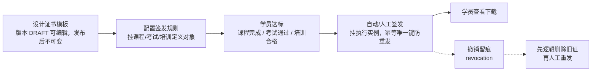

- 模板：`sts_certificate_template`、`_version`（DRAFT 可编辑、发布后不可变）、`_element`。
- 规则：`sts_certificate_issue_rule`，source_type=COURSE/EXAM/TRAINING，规则挂业务定义对象（课程 ID/考试 ID/计划 ID）。
- 签发：`sts_certificate_certificate`，证书挂执行实例（开课/考试/计划），幂等唯一键防重复签发；同（持有人、来源、模板）最多一张未删除证书。
- 撤销重发：`sts_certificate_revocation` 留痕；撤销后重发须先逻辑删除旧证再人工重发。
- 编号、签章、防伪、有效期规则暂定。

**问卷：**

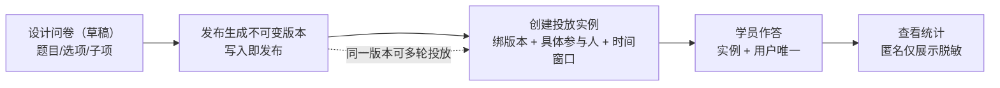

- 定义与版本：`sts_survey_survey`、`_version`（写入即发布）、`_question`、`_option`、`_sub_item`。
- 投放：`sts_survey_instance`，同一版本可多轮投放；全员/部门/指定人员当次展开并写入 `sts_survey_participant`
  ，结果查看由权限与机构隔离控制。
- 作答：`_participant`、`_response`、`_answer*`；按"投放实例+用户"唯一；匿名只影响展示脱敏，内部仍存 user_id 防重复提交。

## 6. 教师（讲师 / 阅卷人 / 评价人）：任务执行流程

> 教师不是独立 RBAC 角色，而是被业务表明确指派的任务归属人；有菜单权限也只能处理被分配的任务。实施状态跟随所属模块。

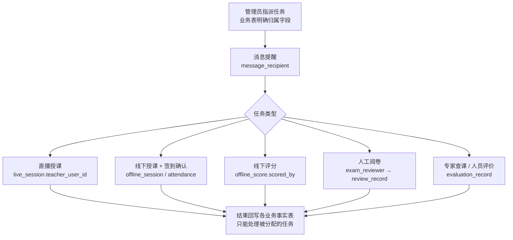

| 任务          | 指派载体                                           | 执行动作                                              | 结果                             |
|-------------|------------------------------------------------|---------------------------------------------------|--------------------------------|
| 直播授课        | `sts_course_live_session.teacher_user_id`      | 按场次时间开播（DRAFT→SCHEDULED→LIVING→ENDED/CANCELLED）   | 学员学习记录落课程学习事实表                 |
| 线下授课        | `sts_training_offline_session.teacher_user_id` | 到场授课、确认签到（`sts_training_attendance.confirmed_by`） | 出勤状态 PRESENT/LATE/LEAVE/ABSENT |
| 线下评分        | `sts_training_offline_score.scored_by`         | 手工录分或导入                                           | 参与综合成绩聚合                       |
| 人工阅卷        | `sts_exam_reviewer`                            | 对 PENDING_MANUAL 的主观题评分（`sts_exam_review_record`） | 评分完成后考试进入待发布                   |
| 专家查课 / 人员评价 | `sts_evaluation_record.evaluator_user_id`      | 按表单版本填写评价（EXPERT_INSPECTION/COMPOSITE）            | 评价结果可参与综合成绩                    |
| 计划负责        | `sts_training_plan.manager_user_id`            | 跟进计划执行                                            | ——                             |

## 7. 学员：学习与考试流程

> 实施状态：课程学习链路**已实施**；考试、培训参与、证书、问卷待对应模块交付。

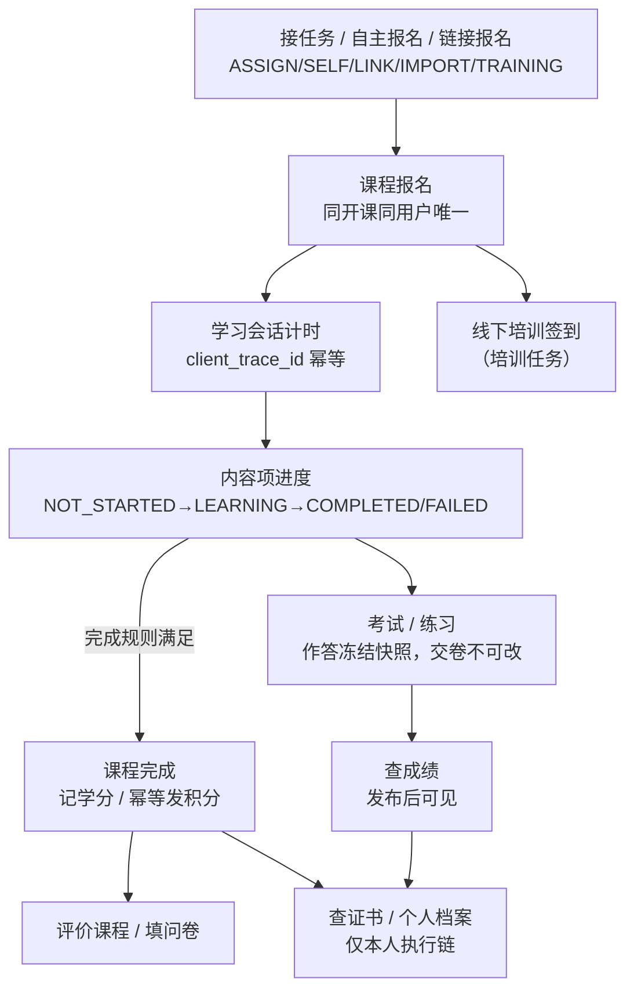

| 步骤 | 操作      | 涉及表                                                                     | 关键规则                                                                                        |
|----|---------|-------------------------------------------------------------------------|---------------------------------------------------------------------------------------------|
| 1  | 进入课程    | `sts_course_enrollment`                                                 | 来源 ASSIGN/SELF/LINK/IMPORT/TRAINING；同开课同用户唯一报名；选修课可在选课大厅自主报名（退选规则暂定）                        |
| 2  | 学习内容项   | `sts_course_study_session` → `sts_course_item_progress`                 | 会话按 client_trace_id 幂等；断点续播、防快进、离页暂停按材料规则执行；视频弹题答错回退                                        |
| 3  | 完成课程    | `sts_course_enrollment.learning_status`                                 | NOT_STARTED→LEARNING→COMPLETED（按完成规则）/EXPIRED；完成后记学分、按积分模式发积分（`sts_common_point_ledger` 幂等） |
| 4  | 参加考试/练习 | `sts_exam_candidate` → `sts_exam_attempt` 及快照/答案表                       | 作答时冻结题目快照；交卷后不可改；防作弊事件（切屏/无操作等）记录并可强制交卷                                                     |
| 5  | 题库练习/错题 | `sts_question_user_state`、`sts_exam_practice_reset`                     | 收藏/错题全局累计；清除练习记录只隐藏当前上下文的历史                                                                 |
| 6  | 评价课程    | `sts_course_evaluation`                                                 | 每报名一条，可匿名展示                                                                                 |
| 7  | 填问卷     | `sts_survey_participant`、`_response`                                    | 按投放实例作答一次                                                                                   |
| 8  | 参加线下培训  | `sts_training_attendance`                                               | 签到/签退，方式暂定                                                                                  |
| 9  | 查个人结果   | 报名/候选人/参训人的成绩字段、`sts_certificate_certificate`、`sts_archive_participant` | 只能访问本人执行链；本人证书可查看下载，他人证书不可见                                                                 |
| 10 | 接收消息提醒  | `sts_common_message_recipient`                                          | 任务下发、开课、考试、成绩发布等触达                                                                          |

学员可凭报名/候选人/参训事实访问跨机构的本人任务，不要求成为主办机构成员。

## 8. 端到端角色协作总览

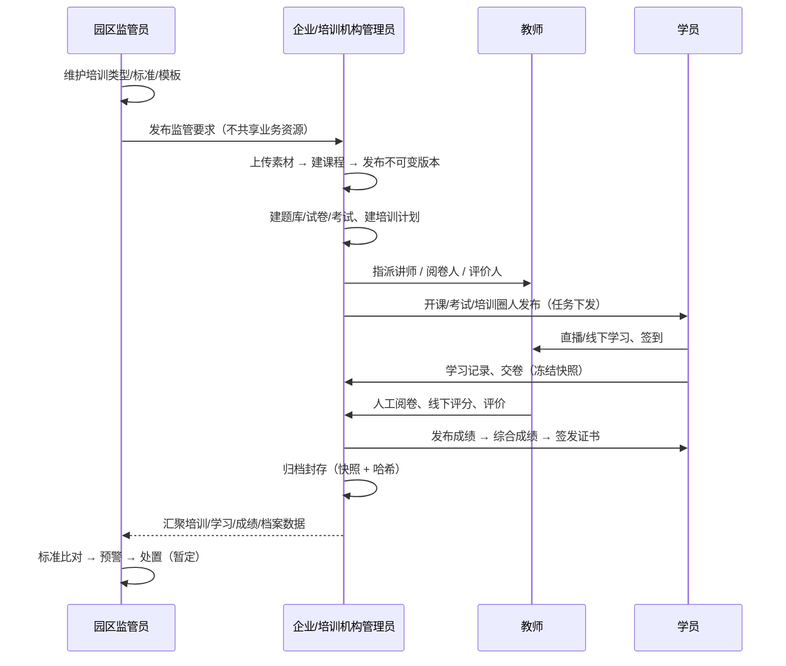

## 9. 实施状态一览

| 流程                      | 所属主线      | 状态               |
|-------------------------|-----------|------------------|
| 系统管理（机构/部门/用户/角色/菜单/字典） | §3        | 已实施              |
| 机构成员档案、角色数据范围（Task 1）   | §3        | 设计通过，待实施         |
| 素材上传与转码                 | §5.1      | 已实施              |
| 课程配置与编排（草稿）             | §5.1      | 已实施（考试类内容项禁用待回接） |
| 课程发布版本                  | §5.1      | 已实施              |
| 开课、报名与学习事实              | §5.1、§7   | 已实施              |
| 题库/试卷/考试/练习             | §5.2      | 设计通过，待实施（阶段 3）   |
| 培训标准/模板/计划/线下执行         | §4、§5.3   | 设计通过，待实施（阶段 4）   |
| 证书/问卷/综合评价/归档           | §5.4、§5.3 | 设计通过，待实施（阶段 5）   |
| 监管统计与预警                 | §4        | 设计通过，待实施（阶段 7）   |
| 仿真、人脸识别                 | ——        | 本期不实施，不设计        |
